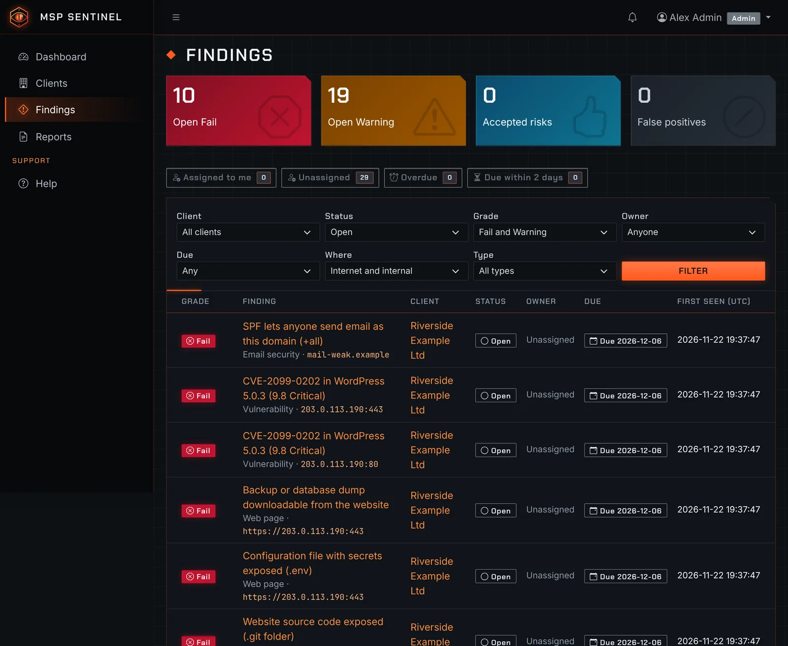
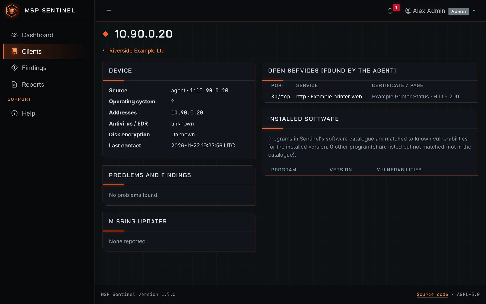
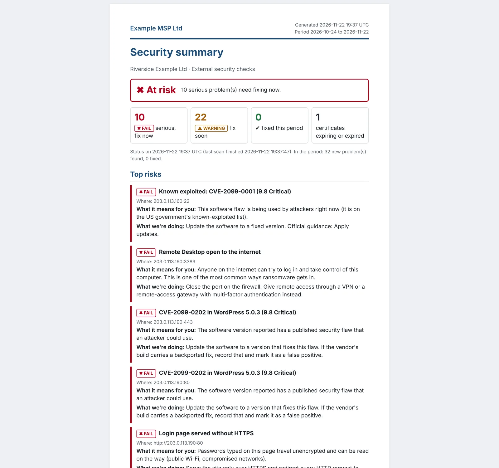

<div align="center">


# MSP Sentinel

**Self-hosted security monitoring for MSPs.** Find what attackers can see and reach, across every client,
inside and outside the network, and get it fixed on time.


[Features](#features) · [Screenshots](#screenshots) · [How it stays safe](#how-it-stays-safe) · [Install](#install) ·
[Documentation](#documentation) · [What's new](#whats-new)

</div>

<p align="center"></p>

## What it is

MSP Sentinel is a security product an MSP runs on its own server and brands as its own. It **detects**: it finds
external exposure and vulnerabilities across your clients, watches them, alerts on them, and tracks the fixes. Its
companion product, **MSP Align**, plans, reports and proves, using Sentinel's findings.

- **Authorised targets only.** Nothing is scanned unless a client approved it in writing and you recorded it in
  Sentinel's "authorised to scan" register. Every active scan is logged.
- **Gentle by default.** Slow, rate-limited TCP connect scans inside each client's scan window, with kill switches.
- **Honest findings.** Versions are never guessed; "confirmed" and "possible" are kept apart; nothing is called fixed
  unless a check proved it.
- **Your data stays yours.** Self-hosted, white-label reports, free software under the AGPL-3.0.

## Features

| | |
|---|---|
| **External exposure** | Passive discovery of forgotten hostnames (DNS, certificate logs), gentle port scans, exposed admin pages, VPN portals and remote access, TLS certificate checks |
| **Website and email** | HTTPS and security headers, cookies, exposed `.git`/`.env`/backups (proved by content), CMS and JavaScript library versions, SPF, DMARC and DKIM |
| **Vulnerabilities** | Matched with NVD, CISA's known-exploited list (KEV) and EPSS; "confirmed" for exact versions, distribution builds and unknown versions treated honestly |
| **Inside the network** | On-premises agent (Linux appliance, outbound only, signed scope): devices, services, certificates, new-device alerts, and risky protocols (SMBv1, SMB signing, RDP without NLA, default SNMP, Telnet, FTP) |
| **Internal devices** | From NinjaOne (read-only) and the on-premises agent: installed software matched to CVEs, unsupported Windows, antivirus, disk encryption and missing updates (connector coming) |
| **Fix workflow** | Triage (accepted risk, false positive), owners, due dates by severity, overdue reminders, and *verify fix* rechecks of a single finding |
| **Alerts** | In-app bell, email and Teams/Slack webhooks; immediate alerts for new Fails, digests, daily reminders |
| **Reports** | Branded executive and technical reports with plain-English fixes, frozen with a SHA-256, monthly email schedule, CSV export |
| **Dashboards** | Command-view dashboard with a 0–100 risk score per client, trends, attack surface and live activity |
| **API** | Read and (opt-in) write API with scoped, expiring tokens, plus signed outbound events |
| **Operations** | One-command installer, encrypted backups, health checks, update check, data retention, audit log |

## Screenshots

<table>
  <tr>
    <td width="50%"><br><sub><b>Client overview</b> (light theme): risk score, findings, attack surface.</sub></td>
    <td width="50%"><br><sub><b>Findings</b>: owners, due dates, overdue and due-soon quick links.</sub></td>
  </tr>
  <tr>
    <td><br><sub><b>A finding</b>: owner, due date, <i>verify fix</i> and full history.</sub></td>
    <td><br><sub><b>Website and email</b>: headers, exposed files, CMS versions, SPF/DMARC/DKIM.</sub></td>
  </tr>
  <tr>
    <td><br><sub><b>On-premises agents</b>: signed internal authorisation, check-ins, kill switch.</sub></td>
    <td><br><sub><b>Internal device</b>: open services, certificates, software and findings.</sub></td>
  </tr>
  <tr>
    <td><br><sub><b>Executive report</b>: branded, plain English, frozen with a SHA-256.</sub></td>
    <td><br><sub><b>Sign-in</b>: two-factor authentication is mandatory.</sub></td>
  </tr>
</table>

All screenshots use made-up clients and documentation addresses only.

## How it stays safe

- **Scope is enforced at the moment of scanning**, against an active, approved authorisation, with a global kill
  switch and a pause per client and per site.
- **Agents scan only what was approved for their site**: internal authorisations and every job are signed with a key
  that is not in the database, and the agent checks the signatures and its own site before it touches anything.
- **Sign-in** with mandatory TOTP two-factor authentication, three roles, CSRF protection on every form, a strict
  Content Security Policy, and everything escaped on output.
- **Secrets** are encrypted with libsodium; tokens and recovery codes are stored only as keyed hashes.
- **Outbound requests** are pinned and never follow redirects; **reports** run no scripts.

More in [docs/security.md](docs/security.md), [docs/agent.md](docs/agent.md) and
[docs/responsible-use.md](docs/responsible-use.md). Sentinel is **not a PCI ASV scan** and not a penetration test.

## Install

One line on a fresh **Debian 13** VM (Debian 12 and Ubuntu 24.04 also work):

```sh
curl -fsSL https://raw.githubusercontent.com/MSP-ALIGN/MSP-Sentinel/main/install.sh | sudo -E bash
```

A guided install walks you through seven steps and shows a summary before it changes anything:

1. Host name
2. HTTPS: Let's Encrypt, self-signed, or behind your reverse proxy
3. Firewall (ufw)
4. fail2ban
5. Automatic security updates
6. Backup encryption passphrase
7. First admin

It then sets up Nginx, PHP-FPM 8.4, MariaDB, the database, a fresh app key, cron jobs, HTTPS and log rotation. Upgrade later with
`sudo msp-sentinel-update`, or with **Update now** under Administration → System. The step-by-step guide, unattended installs and signed release archives: see [docs/install.md](docs/install.md).

A development server that follows the `develop` branch, to try changes before production (marked
**Development build** in the web interface):

```sh
curl -fsSL https://raw.githubusercontent.com/MSP-ALIGN/MSP-Sentinel/develop/install-dev.sh | sudo -E bash
```

For an on-premises agent at a client site (asks for the Sentinel address and the one-time code):

```sh
curl -fsSL https://raw.githubusercontent.com/MSP-ALIGN/MSP-Sentinel/main/install-agent.sh | sudo -E bash
```

### Requirements

- PHP 8.4 (8.3 works), with the extensions `pdo_mysql`, `sodium`, `mbstring`, `openssl`, `curl`, `simplexml` and `gd`
- MariaDB 10.6 or newer
- **nmap** 7.x for port scanning (`apt install nmap`). It is not bundled; its licence is the NPSL.
- A web server that sends requests to `public/index.php` (Apache with the included `.htaccess`, nginx, or similar)
- HTTPS in production

## Documentation

| Guide | |
|---|---|
| [User guide](docs/user-guide.md) | Roles, the client workflow, grades, fix workflow |
| [Install](docs/install.md) | Installer, what it sets up, manual install on other systems |
| [Upgrade](docs/upgrade.md) | `install.sh --upgrade`, manual upgrades, rolling back by hand |
| [Configuration](docs/configuration.md) | Every `config/config.php` option and environment variable |
| [On-premises agent](docs/agent.md) | Safety model, schedule, install, operations, what is graded |
| [Security](docs/security.md) | What Sentinel protects, and your hardening checklist |
| [Responsible use](docs/responsible-use.md) | Authorisation, gentle scanning, honest reporting |
| [Authorisation form](docs/authorisation-form.md) | A template for the client's written approval |
| [Pen-test engagements](docs/engagements.md) | Deeper, time-boxed tests with a report and retest letter |
| [Backup and restore](docs/backup.md) | Daily encrypted backups, restore, moving servers |
| [Operations](docs/operations.md) | Cron jobs, health checks, logs, retention, troubleshooting |
| [API](docs/api.md) | Tokens, endpoints, signed outbound events |
| [Design](docs/DESIGN.md) and [Roadmap](docs/ROADMAP.md) | How it is built, and what is next |

The same help is built into the app (**Help** in the menu), with a "What's new" page for every release.

## What's new

### 1.31.1 (2026-11-24): grouped findings, fixes from review

- **Reports group exactly like the Findings list.** An issue with both Fail and Warning targets is one entry, under
  Fail. Headings count issues and findings.
- **Report snapshots hold each finding once** (before, the grouping stored them twice). A report too large to store
  is refused with a clear message.
- **The assignment email says how many findings** were assigned ("and N more") and links to the assignee's list.
- **A group's due date can go back to the policy**, recomputed once per client.
- **Bulk verify carries on** when one finding can't be rechecked.
- **Due-date filters** ("Overdue", "Due soon") sort groups by the nearest deadline.
- **Large groups load faster:** at most 100 targets per group are read (the rest via "Show all").
- **Layout:** an opened group keeps its other columns at the top.

### 1.31.0 (2026-11-24): grouped findings

- **Repeated findings are one row.** The same CVE, or the same problem, on several targets of one client is grouped
  in the Findings list ("on 3 targets"). Open the row to see each target. **One row per target** switches back.
- **Act on a whole group at once** (technicians and admins):
  - assign;
  - accept risk, false positive or reopen, with one note;
  - verify fix on each target;
  - one due date (admins).

  Each finding is checked exactly as a single click would check it: resolved and archived findings are skipped, and
  the verify limits apply. Each one is audited on its own, and the assignee gets one email for the group.
- **Reports list each problem once** with every target it was found on. Per-target evidence is in a small table,
  and the executive summary's top risks count issues, not targets.
- **Each target is still its own finding.** It is fixed, rechecked and resolved on its own.
- Grouped ITFlow tickets (one ticket per issue) follow in the next release.

### 1.30.1 (2026-11-24): share check, fixes from review

- **No false "anyone can list the shares" finding.** A server that refuses the list answers an empty list with
  "access denied" (Samba's "restrict anonymous = 1"). Before, that empty answer counted as a list.
- **Counts are honest.**
  - An empty drive root counts as readable with 0 items. Before, it was "not readable".
  - A count that didn't reach the end says "at least N".
  - A share that opened but couldn't be counted in time says so, instead of showing 0.
- **Long share names** (over 80 characters) are opened with their full name. Only the evidence is shortened.
- **Samba's anonymous sessions** are labelled anonymous, not guest.
- **Unsolicited server notices** no longer end the check for that host.
- **Docs:** servers that require SMB encryption show as refused. The check can miss an open share there, but never
  invents one.

### 1.30.0 (2026-11-24): safe SMB share check

- **The engagement's anonymous access test now checks Windows and NAS file shares.** It uses Sentinel's own SMB2
  client:
  - it signs in **anonymously**, with no username at all, so no account can ever be locked;
  - it reads the share list;
  - it opens each disk share's top folder for listing only and counts the items in it.

  It never opens a file, never goes into a subfolder and never writes. nmap's share script is still not used, because
  it writes a test file.
- **Evidence:** share names and item counts only, never file names.
- **Findings:**
  - a share readable without a password is a Fail;
  - a share list handed out to anyone is a Warning (a Fail from the internet).

  The report explains why open shares matter (ransomware spreads through them).
- **External and internal.** Internal runs need agents 1.30.0 for the share check; older agents still run the rest
  of the test.

### 1.29.1 (2026-11-23): default passwords, fixes from review

- **No username is ever tried twice on one host.** A device often serves the same login on several ports (80, 443,
  8080, FTP): before, each port got its own three attempts. The 5-second spacing now also applies between services.
- **Windows accounts are never tried.** IIS, WinRM/HTTP.sys (ports 5985, 5986, 47001) and IIS FTP are skipped, and
  so is any web page that also offers Windows sign-in (Negotiate/NTLM): its Basic login checks directory accounts.
- **Re-runs don't repeat attempts.** Running the tests again in the same engagement keeps the earlier result. A
  retest tries only the accounts that worked before, once each, to confirm they were changed.
- **A redirect no longer counts as a login.** Some devices answer a wrong password with a redirect.
- **At most 10 minutes per host** for this test.
- **More lockout answers recognised:** MariaDB's "account locked", and FTP replies that mention a lock or too many
  attempts.
- **Stricter checks on agent results** (a mask must hide something) and on the test-only spacing setting.
- **Internal runs now need agents 1.29.1** (1.29.0 agents don't have these limits).

### 1.29.0 (2026-11-23): default passwords in pen-test engagements

- **New engagement test: vendor default passwords.** It needs a second tick confirming the signed authorisation
  explicitly allows it (a new line in the annex, P3).
  - Services: FTP, web admin pages that ask for a Basic login, MySQL/MariaDB and PostgreSQL.
  - At most **three** published vendor defaults per service. Each uses a different account, so no account ever sees
    more than one failed attempt.
  - Attempts run one at a time, 5 seconds apart, and stop at the first success or at any lockout, block or
    "too many attempts" answer.
  - A login that works is closed at once; nothing is read.
  - Never SSH, Windows, Remote Desktop, WinRM or directory logins.
- **Databases open without a password:** Redis, MongoDB, Elasticsearch/OpenSearch and Memcached are checked without
  guessing. Open is a Fail (Memcached inside the network: Warning).
- **The password is never stored.** The evidence shows the username and the password masked (`a•••n`).
- **Runs externally and through the site agents.** Internal runs need agents 1.29.0 or later; older agents aren't
  given the job.
- **The report says exactly what was tried,** and the attack paths explain what a working default password means.

### 1.28.1 (2026-11-23): attack-surface checks, fixes from review

- **A zone with a wildcard record (`*.client.example`) is now reported as open.** Before, the name stopped the check
  and the open zone transfer was missed. Names in a zone are now read leniently and made safe for display.
- **A takeover check that can't decide keeps the earlier result.** A DNS failure or an unanswered web request no
  longer closes an open finding (and reopens it the next day).
- **Only public addresses are contacted.** A nameserver or cloud name that resolves to a private, loopback or other
  reserved address (perhaps your own network) is skipped.
- **No takeover reports for names nobody else can claim.** Only Amazon S3 names count for AWS (not load balancers,
  databases or API gateways). A cloud name that no longer resolves counts only where anyone can register it again
  (Azure, Elastic Beanstalk, Heroku). The title now says "an unclaimed name".
- **Pauses and scope changes take effect within one name.** Every name is checked against the live scope right
  before it is checked. The DNS step stops after 10 minutes and continues with the next job.
- **The caps always pick the same names.** The client's own names come first, in a fixed order, so findings don't
  come and go.
- **Demo clients are never DNS-checked**, and removing demo data also removes their DNS results.
- **Stricter zone transfer reading:**
  - exactly our question;
  - complete messages over TCP;
  - "open" only once a record of the zone itself arrives.
- **Linux agent updates stop the agent before swapping folders and before a rollback.** The new repair step then
  can't race them. If the swap fails, the agent is started again.

### 1.28.0 (2026-11-23): attack-surface checks

- **DNS zone transfers.** For each domain in the authorisation, Sentinel asks each of the domain's own listed
  nameservers (at most 4, two addresses each) for a zone transfer, once a day at most. A nameserver that hands out the
  whole zone is a Fail: anyone can list every name, including internal and forgotten systems. Only the first part of
  the answer is read (enough to prove it and show a few names).
- **Subdomain takeover.** Each authorised name, and each in-scope name seen on the client's addresses, is checked for a
  CNAME to a cloud service (Amazon S3, GitHub Pages, Heroku, Azure, Shopify and others) that no longer exists. Either
  the cloud name no longer resolves, or one request to the client's name gets the provider's own "no such site" page.
  Both are Fails: anyone could claim the name and serve content on the client's domain.
- **More management pages recognised:** hypervisors (VMware ESXi and vCenter, Proxmox, XenServer and XCP-ng,
  Nutanix), out-of-band management (iDRAC, iLO, IPMI and other BMCs, XClarity), NAS devices (Synology, QNAP,
  TrueNAS, unRAID, ReadyNAS, TerraMaster) and more network devices (UniFi, MikroTik, Omada). Each is a Fail when
  reachable from the internet. A product named only in a page's text is not flagged.
- **Default ports added:** 902 (VMware ESXi management, high risk), 5000 and 5001 (NAS admin pages), 8006 (Proxmox)
  and 9090 (management consoles). Agents check 902, 5001 and 8006 too.
- **The client's website card** has a DNS table: each nameserver's answer and each name's takeover check.
- **Fix: a Linux agent update stopped half-way (power cut between the two renames) now repairs itself.** The agent's
  service and the update helper put the previous version back before anything runs, so the agent starts again on
  its own. Before, the helper's code was in the missing folder, so nothing could repair it. Agents get this with their
  next update.

### 1.27.1 (2026-11-23): pen-test engagements, fixes from review

- **Anonymous access no longer lists SMB shares.** nmap's script for that writes and deletes a test file in every
  share, which breaks "nothing is written". Anonymous access now means FTP and NFS (read only).
- **nmap's "safe" scripts now exclude vulnerability checks.** Some of them send attack-like requests.
- **External engagement results are evidence only.** They no longer change the client's day-to-day services,
  certificates or findings (as the docs said).
- **All 65,535 ports need the normal pace.** At the gentle pace one host would take about 7 hours.
- **Exclusions are given as addresses, not names.** Agents also leave excluded hosts out of the discovery sweep.
- **The retest letter marks a finding "fixed" only when the same test ran again** and the host was tested to the end.
  IPv6 hosts are matched correctly.
- **When nmap can't run, an external engagement job fails** instead of queuing more jobs.
- **Clearer texts:** the test descriptions, the 200 packets a second limit, the cancel message for stopped
  engagements, and the docs (stop timing, how slices work, scope checks).

### 1.27.0 (2026-11-23): pen-test engagements

- **Pen-test engagements** (Client → Pen-test engagements): time-boxed, deeper tests the client authorises in
  writing. You attach the signed PDF; Sentinel keeps its SHA-256.
- **Only inside the authorised scope.** Each engagement has its own exclusions and a window of at most 14 days.
- **A different admin approves it**, with their password. **Stop engagement** is a kill switch that ends it for good.
- **Tests, chosen per engagement:**
  - all 65,535 TCP ports;
  - common UDP services (SNMP, NTP, SSDP; one read-only request each);
  - nmap's safe scripts;
  - anonymous-access checks (FTP, NFS, SMB file shares; read only).

  The pace is gentle or normal (never faster). No password guessing, no exploits, nothing that changes the systems.
- **External tests run from Sentinel.** They run in 20-minute slices, and every host is checked against the
  engagement, its exclusions and the live scope before and during the test.
- **Internal tests run through the site agents** (agents must be 1.27.0 or later). The job is signed with the
  targets, exclusions, tests and end time. Agents stop on their own at the end time.
- **Findings come from the evidence:** anonymous FTP, SMBv1, open shares, SMB signing, NFS exports, SNMP default
  communities, UPnP and services exposed to the internet.
- **Penetration test report** (branded, frozen): summary, how the findings chain together, scope and authorisation,
  method, findings with evidence and fixes, systems tested. CSV export.
- **Retest letter** from a retest engagement: each earlier finding is marked fixed, still open or not retested.
- **New authorisation template annex** for engagements. See [docs/engagements.md](docs/engagements.md).

### 1.26.2 (2026-11-23): Windows agent, fixes from re-review

- **A fresh install creates its ProgramData folder itself.** It fails if someone recreated the folder in between,
  replaces the whole permission list in one step, and checks that nothing got in. A local user racing the install can
  no longer keep write access.
- **`-Upgrade` only trusts folders it made.** It refuses unless the service exists and the data, config and update
  folders are writable only by Administrators and SYSTEM.
- **nmap installs no longer fail because of an empty exit code.**
- **An update interrupted by a crash or reboot no longer leaves the service disabled or stopped.** The next update
  task run starts it again, and `-Upgrade` resets its start mode.
- **The update task is harder to fool and keeps more on failure:**
  - it checks the state folder afresh on every read, and logs when the folder is redirected;
  - it retries folder renames;
  - it keeps the failed copy when a rollback fails;
  - it logs when its result can't be written.
- **Agents installed with 1.26.0 need `install-agent.ps1 -Upgrade` once.**

### 1.26.1 (2026-11-23): Windows agent, fixes from review

- **The agent's service has only two privileges.** It can no longer impersonate clients, which known tools turn into
  SYSTEM (`sc privs`).
- **Updates can swap the code folder.** The update task now runs through a small launcher outside that folder.
  Windows can't rename a folder that holds an open file, and the launcher also repairs a half-finished update.
- **TLS uses the Windows certificate store.** PHP's curl has no CA bundle of its own on Windows.
- **The installer never acts through links or junctions** the agent could create:
  - it checks its folders before changing permissions on `-Upgrade`;
  - it deletes with `rmdir /s`, which removes links but never what they point to;
  - a fresh install starts from a new ProgramData folder owned by Administrators.
- **The update task:**
  - refuses a redirected state folder;
  - disables the service while it swaps folders, checks every rename, and says so if a rollback fails;
  - writes its result reliably;
  - keeps a log (`update\task.log`).
- **Installer details:**
  - WinSW's .NET Framework build;
  - nmap's publisher checked, and a time limit if its installer isn't silent;
  - no empty password argument;
  - the Visual C++ runtime version checked;
  - an absolute PHP extension folder;
  - each permission change checked;
  - the code wiped from memory;
  - `-Upgrade` pauses the update task and restarts the service if it fails.
- **The Windows command sets TLS 1.2 first.** The docs say exactly what is checked and what still needs testing on
  Windows.

### 1.26.0 (2026-11-23): Windows agent (preview)

- **The on-premises agent runs on Windows Server 2022/2025 and Windows 11**, installed with one PowerShell command (as
  administrator) shown on the enrolment page next to the Linux ones.
- **What the installer sets up:**
  - PHP 8.4, checked against windows.php.net's published SHA-256;
  - nmap without Npcap, checked against nmap.org's SHA-256 and its signature;
  - WinSW, with its SHA-256 pinned;
  - the "MSP Sentinel Agent" service, running under its own virtual account without admin rights, with only two
    privileges (no impersonation);
  - tight folder permissions.
- **Updates from Sentinel, built like the Linux ones.** A SYSTEM task downloads the release itself and checks it with
  the pinned release key, then installs it and rolls back if the service doesn't stay up. It never writes or deletes
  in the agent's own folder, and reads only the agent's small request from it (not through links or junctions).
- **Same agent program on both platforms.** Windows differences: MAC addresses come from `arp -a`, and there is no
  name-poisoning listener (Windows owns those ports). Scans are slower without Npcap.
- **Preview:** the PowerShell installer still needs testing on real Windows machines. See
  [docs/windows-agent.md](docs/windows-agent.md).

### 1.25.0 (2026-11-23): agent install steps

- **"How to add an agent" on the Agents card**: open until a client has its first agent.
- **The enrolment page has everything for the install**:
  - requirements (OS, size, bridged network, outbound HTTPS only);
  - the one-line and archive install commands with your Sentinel address, with copy buttons (the code is typed at
    the prompt, never put on a command line);
  - how to check it worked, including the release key fingerprint to expect;
  - troubleshooting.
- **It warns when the site has no internal authorisation valid today**, so the agent won't scan yet.
- **The one-line installer accepts `SENTINEL_CA=/path/ca.pem`** for a Sentinel with a private CA.
- Help topics can be linked directly.
- **Fixes from the second release-key review:**
  - The update helper never treats a damaged or wrongly owned key as "nothing pinned", so Sentinel can't slip in a
    new key that way.
  - The System page and `bin/release-sign.php` now list exactly the same files, so the manifest hashes match.
  - The installer reads the enrolment key as JSON.
  - The docs are more precise about what the app key protects (and that restoring an old value brings an old key
    back).

### 1.24.1 (2026-11-23): release key, fixes from review

- **Agents given the key at enrolment can now be updated.** The update helper only looked for the key file, so
  these agents refused every update.
- **The release key is stored authenticated with the app key**, so a database write alone can't plant a key agents
  would trust. A key made with 1.24.0 must be made again.
- **Only the release's own files are signed and sent to agents:** its own folders and file types. Other files left in
  Sentinel's folder (a backup, a dump) are no longer included.
- **Before signing, the page shows the manifest's SHA-256 and every file.** Compare the hash with the one in the
  release notes (`bin/release-sign.php sign` prints it).
- **Agents follow several rotations** (each step signed by the key before), not just the last one.
- **The agent installer prints the release key fingerprint at enrolment**, and the System page lists agents that have
  no key yet.
- **The docs now say what the key does and doesn't protect.** An agent with no key yet trusts the first key Sentinel
  gives it. Signing in a page Sentinel serves means a compromised server could copy the key file and its password
  while you use them.
- The key file name now includes its fingerprint. A pinned key is never overridden by a key file in a release folder.

### 1.24.0 (2026-11-23): release key in the web UI

- **The agent release key is created and used on Administration → System, in your browser.** The private key
  downloads as a password-protected file to your computer and never reaches Sentinel; Sentinel keeps only the public
  half. The key doesn't expire.
- **Sign each version from the System page** by picking the key file and typing its password. Only the signature is
  sent.
- **Agents learn the key from Sentinel:** at enrolment, or at their next check-in through the root update helper when
  they have none. A pinned key never changes by itself.
- **Rotate the key** with the old key file: the old key signs the change, so agents switch on their own. **Replace**
  it if the file is lost; agents then need the new key by hand (`agent-install.sh --release-key`).
- The command-line signing tool remains as an alternative.

### 1.23.2 (2026-11-23): agent moves, fixes from re-review

- **Older agents are never asked to move.** Only agents at 1.23.1 or later get move instructions, because 1.23.0
  agents sent their token before the proof.
- **Moves made by 1.23.0 agents are kept** when those agents update, instead of being dropped.
- **"Move complete" and "Cancel and recall agents" are now separate.** Move complete stops asking agents and keeps
  moved agents where they are. Cancel brings them back. Both need your password, and the page says what each does.
- **Password re-entry is throttled and failures are audited,** the same as on the profile page.
- **A 200 that isn't Sentinel's answer** counts only as a failed check-in at a new address.
- **After probation, a refusal at the new address no longer sends the agent back.**
- **Recall also notices a changed CA for the same address.**
- **Docs:** the limit on who can set a move is corrected.

### 1.23.1 (2026-11-23): agent moves, security fixes from review

- **No secrets go to an unproven address.** The new address is asked for its proof without the agent's token.
  1.23.0 sent the token first, so a mistyped or rogue address could collect agents' tokens.
- **The proof names the address.** Sentinel only signs proofs for the address an admin set, so a host that relays the
  challenge to the real Sentinel can't pass.
- **Starting a move needs your password**, and the move setting is encrypted and authenticated with the app key, so it
  can't be edited in the database directly (see the limit in docs/agent.md).
- **Agents can always be recalled.** While moved, an agent asks its original address every 6 hours, and comes back
  when the move was cancelled or changed.
- **Fallback only right after a move:** within 24 hours or the first 20 good check-ins. After that the move is
  permanent, so an outage can't strand agents at an old address. A fallback is reported, so the move isn't repeated
  in a loop.
- **Smaller fixes:**
  - Move instructions are limited, so they never stop scans.
  - Any non-answer at a new address counts as a failure, and a token refusal there sends the agent back instead of
    wiping it.
  - Writes are checked.
  - Agents ignore a move file from another enrolment.
  - The configured private CA is reused under a new name.
  - Address changes are audited.
- Moves set in 1.23.0 are cleared; set them again (with your password). Agents need 1.23.1.

### 1.23.0 (2026-11-23): move agents to a new Sentinel address

- **Move every agent to a new Sentinel address** (and a private CA's certificate, if needed) from Administration →
  System, without visiting any site.
- **Each agent only switches after the new address proves it is this Sentinel.** The new address must sign a random
  challenge with the key the agent pinned at enrolment. Hardened in 1.23.1: the token was sent before the proof.
- **Automatic fallback:** an agent goes back to its old address on its own if the new one fails 10 check-ins in a row.
- The System page shows each agent's state: moved, waiting, not moved (and why), or needing an update first.
- This completes managing agents from Sentinel: after the one-time install with an enrolment code, settings,
  diagnostics, restarts, updates and address moves all happen from the web UI.

### 1.22.2 (2026-11-23): agent updates, fixes from re-review

- **Repeat updates work.** In 1.22.1, the update helper's sandbox stopped the collector from removing the update
  request. After the first remote update, the helper restarted in a loop and later updates were ignored. The collector
  (running as the agent's user) can now remove it. The agent also removes a request the helper already answered, or
  one older than an hour.
- **Updating from 1.22.0 works.** The helper's result folder is created before its sandbox starts. A result left by
  the 1.22.0 helper is read once. A request is marked done once the agent runs the version asked for, even if its
  result was lost.
- **Safer swap:**
  - The agent must stay up for 50 seconds without restarting, or the previous version is put back.
  - A rollback that can't complete never leaves the appliance without an agent.
  - An update interrupted half-way is repaired on the next run.
- **Smaller fixes:**
  - The collector runs via `setpriv`, so a timeout reaches it.
  - The self-check must report the exact version being installed, and checks for PHP 8.3.
  - Results survive odd characters.
  - `release-sign` lists files that aren't part of the agent release.

### 1.22.1 (2026-11-23): agent updates, security fixes from review

- **Security fix:** the root update helper no longer reads, writes or deletes anything in the agent's own folder.
  The agent's user could plant symlinks there and get a root-owned file overwritten. A collector running as the
  agent's user now hands the staged release to the helper, which checks it in memory. Results go to a root-owned
  folder the agent can only read, and the agent cleans up its own staging. Versions that aren't x.y.z are never used.
- **Pre-flight and rollback:** the new release's self-check runs as the agent's user before anything is swapped. If
  the updated agent doesn't stay running, the previous version is put back automatically.
- **A stuck update can't stop scans.** A request is handed out at most 3 times, 30 minutes apart, with scans in
  between, then ends with a clear message.
- **Releases are signed exactly as the release archive ships them**, so Sentinels installed from the tarball can hand
  out every file.
- **Smaller fixes:**
  - The helper's systemd service is hardened, and limited to 5 starts in 10 minutes.
  - An unreadable installed version is refused.
  - "Update to" can be pressed again for a newer release.

### 1.22.0 (2026-11-23): agent updates from Sentinel

- **Update agents from Sentinel.** Use **Update to x.y.z** per agent, **Update all agents** per client, or **Update all
  agents** under Administration → System. Agents update at their next check-in between scans, download the release
  from Sentinel (no GitHub access needed at client sites) and report the result.
- **Only code signed with your release key is installed.** The key is pinned on each agent and never changed by an
  update. A root helper on the appliance checks the signature, the version (no downgrades) and every file again
  before installing. Sentinel can ask for an update but its own keys can't vouch for code (limits in
  [docs/agent.md](docs/agent.md#updates-from-sentinel-122), "What the release key protects").
- **New `bin/release-sign.php`** (for you only): `keygen` once, then `sign` for each release (see
  [docs/agent.md](docs/agent.md#updates-from-sentinel-122)). Until the release key is set up and a release is signed,
  no updates are offered.
- **Upgrade existing agents once by hand** (`agent-install.sh --upgrade`) to get the update helper and the pinned key.

### 1.21.1 (2026-11-23): agent settings, fixes from review

- **Restart, Diagnostics and Scan now are no longer lost.** Check-ins during a running scan, and the agent's
  `status` command, used to take these requests and ignore them. Now only the agent's idle check-ins between scans
  receive them. A restart is handed out on its own, so a queued scan isn't marked as sent and then expired. This also
  fixes an older problem: a scan queued while another was running could expire without running.
- **Honest gentleness settings:**
  - *Very gentle* now keeps nmap's polite timing with one probe at a time, at most 10 a second. The old `-T1`
    template waited 15 seconds between probes and couldn't finish real scans.
  - *Faster* (nmap `-T3`) is labelled as the much heavier traffic it really is.
- **Older agents are flagged.** The Agents page says when an agent older than 1.21.0 ignores these settings.
- **Diagnostics** are labelled as reported by the agent, and a key fingerprint that doesn't match the pinned key is
  flagged.
- **Smaller fixes:**
  - Requests are taken atomically.
  - Odd numbers in a report can't wipe it.
  - The settings audit entry records the old values.
  - Messages reflect longer check-in intervals.
  - Tests prove the external scanner always uses the default timing.

### 1.21.0 (2026-11-23): agent settings from the web UI

- **Manage agents from the client's Agents page** (admins) after the one-time install:
  - **Scan gentleness per site:** very gentle, gentle (the default) or faster (labels and timings corrected in
    1.21.1). It is signed into each job, and the agent refuses anything else.
  - **Check-in interval per site:** 30 seconds to 10 minutes.
  - **Diagnostics:** a report from the agent with versions, disk, memory, load, uptime, clock difference with
    Sentinel, key fingerprint and whether it holds a directory password. Never a secret.
  - **Restart:** between scans; the agent's service starts it again.
- Next: signed agent updates from Sentinel, then moving agents to a new Sentinel address.

### 1.20.1 (2026-11-23): Active Directory checks, fixes from review

- **The agent's key is pinned.** A changed key no longer replaces the old one silently. It waits on the Agents page
  until an admin compares its fingerprint, which the agent's `status` command now prints, and approves it. Nothing
  is sealed to an unapproved key, so someone holding an agent's token or with database access can't have the next
  password sealed to a key of their own.
- **A re-sent password is confirmed again.** Before, if the agent's confirmation got lost, a password the agent held
  showed as "failed (replay)". An old sealed password sent again under a new drop ID is refused.
- **NetBIOS:** only broadcast name queries count. Node-status queries from inventory tools and RMMs are no longer
  reported as name poisoning, and the appliance never reports itself. The finding closes only after three quiet
  listens in a row.
- **Domain Admins is found by its well-known SID**, so localised names work. Members through their primary group
  count too.
- **Smaller fixes:**
  - A password for an account that was changed is deleted from the agent, as is the password of a revoked agent.
  - An undecided LDAP signing probe keeps the earlier answer.
  - Turning the checks off closes their findings at once.
  - "Saved" is no longer shown when the page's script didn't run.
  - An unusable key file only turns off the AD checks, not the agent.
  - Paging is guarded against a domain controller that repeats pages or sends too much.

### 1.20.0 (2026-11-23): Active Directory checks

- **Active Directory checks through the on-premises agent** (first item of
  [docs/ROADMAP-security.md](docs/ROADMAP-security.md)). With a read-only domain account, the agent reads the
  directory at each full scan. Nothing is changed. Balanced grading:
  - **Fail:** AS-REP roastable accounts, Kerberoastable admin accounts, unconstrained delegation outside the domain
    controllers.
  - **Warning:** other Kerberoastable accounts, more than 5 Domain Admins, admin passwords that never expire, a
    krbtgt password over a year old, missing LAPS, LDAP signing not required, stale admin accounts.
  - Each finding lists up to 25 names, with step-by-step fixes in reports and ITFlow tickets. The findings also count
    on the Compliance page.
- **The password is sealed for the agent, never readable in Sentinel.** Your browser encrypts it to the site agent's
  own key (Web Crypto). Sentinel relays the sealed box, signed, and deletes it once the agent confirms. The agent keeps
  it sealed and opens it only for the sign-in. Replace it any time from the Agents page; the page shows when the agent
  last confirmed it.
- **The domain controller's certificate is trusted before the first sign-in.** The agent signs in over LDAPS only
  when the certificate matches the one you trusted. A changed certificate gets nothing.
- **LDAP signing** is checked with a made-up account; the real password never goes over plain LDAP.
- **Name poisoning:** the agent listens for 2 minutes per full scan for LLMNR/NetBIOS name requests and never
  answers. Devices sending them are a Fail.
- **Agent changes:**
  - The agent gets its own key pair, created on the appliance.
  - The service gets one capability (`CAP_NET_BIND_SERVICE`) to listen on UDP 137.
  - Agent files live in `/var/lib/sentinel-agent`.
  - Upgrade agents with `--upgrade` to use these features.

### 1.19.2 (2026-11-23): faster ticket lookup, device evidence tested

- **After an unclear answer from ITFlow, Sentinel looks for the ticket from the newest end** of the client's ticket
  list. It stops at tickets older than the create call, instead of reading the list from the oldest. Clients with
  thousands of tickets are handled in a few small reads, and no longer fall back to opening the ticket again with a
  duplicate warning.
- **New test:** a device finding counts as still there only when device data received after the ticket was closed
  still shows it. A refresh from stored data doesn't count.

### 1.19.1 (2026-11-23): two-way ITFlow tickets, fixes from review

- **A ticket is reopened only on clear evidence.** That means a "verify fix" recheck after the close that still sees
  the problem, or new device data that still shows it. Before, any findings refresh from stored data counted (the
  daily vulnerability update, a scan of another host, a recheck that couldn't tell), so a fixed problem could get its
  ticket reopened or replaced.
- **Rechecks follow the same limits as the button:** at most one per finding every 10 minutes, and the usual caps on
  waiting rechecks. They also wait for the client's scan window, since no person asked for them.
- **A ticket is given up as gone only after two "not found" answers an hour apart.** ITFlow answers "not found" for
  its own errors too. A finding whose ticket was deleted gets a new one while it's open.
- **A ticket whose create call got an unclear answer is looked for on two runs before it's opened again.** If it
  can't be settled, it's opened again with a note to check ITFlow for a duplicate, instead of blocking ticketing.
- **A problem reopened by hand after its ticket was done is followed again.** So is a problem fixed after Sentinel
  gave up waiting.
- **A refused API key user stops the run.** That covers an inactive or archived user, or a role without the Support
  module. Before, every item was marked failed and then waited up to a day.
- **The "verified fixed" note is sent once,** even if resolving the ticket has to be retried.
- **Smaller fixes:**
  - The first retry comes after 1 hour, as documented.
  - Tickets Sentinel resolved are followed for 30 days, not forever.
  - A refused replacement ticket is retried whatever the finding's severity.
- **Upgrade note:** on the first runs after updating, tickets of findings fixed since they were opened get a
  "verified fixed" note and are resolved, 50 per run.

### 1.19.0 (2026-11-23): ITFlow tickets both ways

- **Two-way status** (phase 3 of [docs/ROADMAP-itflow.md](docs/ROADMAP-itflow.md)):
  - When Sentinel no longer sees a problem, or someone marks it accepted risk or false positive, the ticket gets an
    internal note saying so and is resolved in ITFlow.
  - When a ticket is resolved or closed in ITFlow while the problem is still open, Sentinel checks again. A port or
    email problem gets a "verify fix" recheck at once; a device problem waits for the device's next data.
  - Gone: the finding closes and the ticket gets a "verified fixed" note.
  - Still there: a resolved ticket is reopened with what Sentinel still sees. A closed ticket can't be reopened in
    ITFlow, so it is replaced by a new ticket that names the old one.
  - A problem that comes back after its ticket was resolved reopens the ticket (or replaces it if it was closed).
  - The finding page shows each ticket's state and its earlier tickets.
- **Fixes from the 1.18.0 review:**
  - One ticket that ITFlow refuses (a deleted client, a closed ticket, no access) no longer stops all ticketing. It
    is retried later (after 1, 2, 4… hours) and the reason shows on the finding.
  - The ticket link goes to ITFlow's technician view. Sentinel no longer keeps ITFlow's client guest link, which
    carries a secret key.
  - A ticket whose create call timed out is found again in ITFlow instead of opened twice.
  - Known-exploited is decided from the CISA KEV list, not the finding's title. A finding added to the KEV list after
    tickets were turned on gets a ticket.
  - "Also open tickets for existing Fail findings" no longer sends a weekly Warnings ticket to every client at once.
    The weekly list always shows the new warnings first.

### 1.18.0 (2026-11-23): ITFlow tickets from findings

- **Findings open ITFlow tickets** (phase 2 of [docs/ROADMAP-itflow.md](docs/ROADMAP-itflow.md)): each Fail, and
  anything known to be exploited, gets its own ticket (High; Urgent when exploited) with what was found, where, the
  evidence, why it matters, how to fix it, the due date and a link back to Sentinel.
- Never two tickets for one finding; a finding that becomes known-exploited adds an internal note.
- Warnings are grouped into one ticket per client a week, when there are new ones.
- Tickets are internal (ITFlow doesn't email the client). Turning tickets on covers findings from then on; one button
  opens tickets for the existing Fails too. The finding page shows its ticket.
- Next: Sentinel resolves tickets it sees fixed, and closing a ticket in ITFlow makes Sentinel recheck (done in
  1.19.0).

### 1.17.0 (2026-11-22): clients from ITFlow

- **ITFlow client sync** (phase 1 of the ITFlow plan, see [docs/ROADMAP-itflow.md](docs/ROADMAP-itflow.md)): every
  15 minutes new ITFlow clients are added to Sentinel with their ITFlow ID, renames are applied, and archiving or
  unarchiving in ITFlow is followed. A new client is never scanned until its written authorisation is recorded.
- A Sentinel client with the same name is linked instead of duplicated; a client you archived yourself stays archived.
- With MSP Align connected, clients are linked to MSP Align automatically by their ITFlow ID.
- **Administration → Integrations → ITFlow**: address and API key (encrypted), Test connection and Sync now.
- Next: tickets from findings in ITFlow, and closing them from ITFlow.

<details>
<summary><b>Earlier releases (1.16.0 to 1.0.0)</b></summary>

### 1.16.0 (2026-11-22): compliance from MSP Align

- New **Compliance** page for each client: the frameworks assigned to it in MSP Align, and for every control in an
  area Sentinel checks, either the open Sentinel findings that affect it, "no problems found" (with what was
  checked), or "not checked yet". Read-only: control statuses stay in MSP Align.
- Findings are matched through MSP Align's crosswalk tags, so one mapping covers CIS, NIST CSF, HIPAA, CMMC,
  ISO 27001, PCI DSS, SOC 2, cyber insurance and custom frameworks.
- **Administration → Integrations → MSP Align**: address and API key (encrypted; a read-only key with
  clients:read and compliance:read is all it needs), with Test connection. Admins link each client on its
  Compliance page; the same name is suggested first.

### 1.15.0 (2026-11-22): tabbed settings and vulnerability data on demand

- **Administration → Settings** is now in tabs: General, Alerts, Fix due dates, Report branding and Vulnerability
  data. Links and saves land on the right tab.
- **Refresh now** for vulnerability data (CISA KEV, NVD, EPSS) in the Vulnerability data tab: it starts within
  5 minutes, and the tab shows when it is waiting, running and finished.
- **No more waiting for the first download:** the built-in scheduled job now checks every 5 minutes and refreshes when
  due (daily), so a new server has its vulnerability data within minutes of installing instead of the next morning.
  Existing servers pick up the new schedule with their next update. The health check no longer asks you to add a
  cron job that is already there.

### 1.14.0 (2026-11-22): NinjaOne

- **NinjaOne connector**, read-only, built on NinjaOne's published Public API 2.0. Every 6 hours, each linked client
  gets its computers with operating system (and its support date), antivirus, disk encryption (BitLocker), missing
  Windows updates and installed software, matched to known vulnerabilities. Findings follow the same grades as
  everything else.
- **Administration → Integrations**: enter your NinjaOne instance, client ID and client secret (encrypted, never
  shown again), with step-by-step instructions for the NinjaOne API app (Monitoring scope, Client credentials) and a
  **Test connection** button. Link each client to its NinjaOne organisation on the client's Devices page.
- Honest by design: anything NinjaOne doesn't report stays "unknown" rather than becoming a finding, and a sync with
  a failed page changes nothing.

### 1.13.1 (2026-11-22): Update now fixes

- Clicking **Update now** again within 15 minutes now says when the next update can start, instead of seemingly
  doing nothing.
- Quick repeated clicks no longer switch the server's update helper off (a too-strict systemd limit was removed;
  the helper's own one-update-per-15-minutes rule stays).
- An upgrade no longer stops at "Service files" when that helper is stuck; it resets it, or warns and carries on.
- If a request is not picked up, the System page says how to fix it on the server and lets you remove the request.

### 1.13.0 (2026-11-22): client pages

- Opening a client now switches the left menu to **that client's own menu**: Overview, Findings, External (scans and
  ports, vulnerabilities, certificates and web, website and email), Internal (agents, devices) and Manage
  (authorisations, discovery, reports), with **All clients** to go back. No more one long page.
- Each section is its own page with its own address (for example `/clients/12/devices`), and only loads what it shows.
- The client's forms and device pages keep the client menu; actions return you to the page you were on.

### 1.12.1 (2026-11-22): one-click Update now

- **Update now** is a one-click admin action again (with an "Are you sure?" prompt): no password or 2FA code. The
  server still only runs the normal update (backup first), at most once every 15 minutes, and every request is in
  the audit log.

### 1.12.0 (2026-11-22): update from the web interface

- **Update now** under **Administration → System**, on development and production servers installed with the
  one-line command. It asks for your password and a 2FA code, then runs the same `msp-sentinel-update` as on the
  server (backup first, fetch, database changes, health check) and shows its progress and output.
- The web app still runs without privileges: it only leaves an empty request file, and a small root-owned systemd
  service on the server runs the fixed update command. Admin-only, rate-limited and audited. Turn it off on the
  server with one command (see [docs/upgrade.md](docs/upgrade.md#from-the-web-interface)).
- **Update available** notice: servers that follow a branch see how many new commits it has since their install
  (part of the daily update check, or **Check now**).
- Existing servers get both with their next `sudo msp-sentinel-update`.

### 1.11.0 (2026-11-22): demo data

- **Demo data** for trying Sentinel out, testing or training: four made-up clients with findings of every kind
  (open, assigned, overdue, accepted, false positive and fixed), an on-premises agent with devices and risky
  protocols, inventory devices with patches and installed software, scan history, 90 days of trends and two reports.
- Load or remove it under **Administration → System → Demo data**, or on the server with
  `sudo -u sentinel php /opt/msp-sentinel/bin/demo.php --load` (`--remove`, `--status`).
- **Demo clients are never scanned.** They use `*.example` names and documentation-only addresses, carry a Demo
  badge, and every scan path refuses them: scheduled and manual scans, verify fix, discovery, agent jobs, inventory
  sync and vulnerability look-ups. Removing demo data deletes only demo clients and what belongs to them.

### 1.10.0 (2026-11-22): development servers

- **One-line install for a development server** that follows the `develop` branch, so changes can be tried before
  they reach production:
  `curl -fsSL https://raw.githubusercontent.com/MSP-ALIGN/MSP-Sentinel/develop/install-dev.sh | sudo -E bash`.
  `sudo msp-sentinel-update` keeps it on `develop`.
- Development servers show a **Development build** badge on every page. Administration → System shows the branch
  and commit of every install made with the one-line installer.
- See "Development server" in [docs/install.md](docs/install.md).

### 1.9.0 (2026-11-22): guided install

- The one-line install is now a **seven-step guided install** with a summary to confirm before anything changes:
  host name, HTTPS, firewall, fail2ban, automatic security updates, backup encryption and the first admin.
- **Three HTTPS choices:** Let's Encrypt, self-signed, or **behind a reverse proxy** (Sentinel listens on plain HTTP
  for the proxy's address only and trusts its forwarded headers).
- **Server hardening by default:** ufw firewall (SSH rate-limited), fail2ban for SSH, and Debian's automatic security
  updates. Each can be turned off.
- **Encrypted backups from day one:** set a backup passphrase during install.
- Every answer can also be given as a `SENTINEL_*` environment variable for unattended installs. New installer
  options: `--tls`, `--proxy-ip`, `--no-firewall`, `--no-fail2ban`, `--no-auto-updates`.
- Step-by-step guide in [docs/install.md](docs/install.md).

### 1.8.0 (2026-11-22): one-line install on Debian 13

- **One-line install** on a fresh Debian 13 VM:
  `curl -fsSL https://raw.githubusercontent.com/MSP-ALIGN/MSP-Sentinel/main/install.sh | sudo -E bash`. It asks for the
  host name, certificate and first admin (or takes them from environment variables for unattended installs), and adds
  `sudo msp-sentinel-update` for upgrades.
- The same for on-premises agents: `install-agent.sh`, with `sudo msp-sentinel-agent-update`.
- **Debian 13** is now the recommended system (it ships PHP 8.4, so no extra package source is needed). Debian 12 and
  Ubuntu 24.04 still work.
- The installers ask their questions on the terminal, so they also work when piped from `curl`.

### 1.7.0 (2026-11-22): risky internal protocols

- The on-premises agent now checks each device of a full scan for risky protocols, read-only:
  - **Fail:** SMBv1 enabled, Telnet open, SNMP answering the default "private" community.
  - **Warning:** SMB signing not required, Remote Desktop without Network Level Authentication, FTP open, SNMP
    answering "public", login pages over plain HTTP.
- No logins: SMB and RDP are read from the protocol negotiation. The SNMP check sends one read request with the
  default community names. A check that can't decide is never a finding.
- Plain-English explanations and fixes in reports; findings show on the device page.

### 1.6.0 (2026-11-22): on-premises agents

- **Internal scans** from a small Linux appliance at the client's site (Ubuntu 24.04 or Debian 12). The agent only
  connects out to Sentinel. Weekly full scans (devices, open services and versions, certificates, start pages) and
  daily light sweeps, inside the scan window; admins can scan now with a reason.
- **Signed scope:** each site gets an internal authorisation (private networks only, size-limited) that Sentinel
  signs with a key outside the database. Every job is signed too; the agent checks both signatures and refuses any
  target outside the signed networks. Results outside the authorisation are ignored.
- **Findings:** vulnerable services (distribution builds never "confirmed"), and certificates that are expired,
  accept TLS 1.0/1.1 or use a weak key. **New-device alerts** after a site's first (baseline) scan, unless NinjaOne
  already knows the device.
- **Control:** one-time enrolment codes, revocable agents, a kill switch per site, and an installer with a hardened,
  unprivileged systemd service. See [`docs/agent.md`](docs/agent.md).
- **Internal devices groundwork** for NinjaOne: installed software matched to vulnerabilities (one finding per device
  and program), unsupported Windows versions, antivirus, disk encryption and missing updates, with an Internet /
  Internal filter on the findings list. The NinjaOne connector itself follows in a later release.

### 1.5.0 (2026-11-22): fix workflow

- **Owners:** technicians and admins assign findings to an active technician or admin ("Assign to me" for yourself).
  The new owner gets a notification and an email. Viewers see owners but can't change them.
- **Due dates** for every open finding: known-exploited 7 days, other Fail 14 days, Warnings 30 days, counted from when
  it was first seen or reopened. Admins change the days in Settings, or set one finding's date with a reason.
  Accepted risks and false positives are never due.
- **Overdue at a glance:** overdue and due-soon badges, owner and due filters, and quick links ("Assigned to me",
  "Unassigned", "Overdue", "Due within 2 days").
- **Daily reminders** after 07:00 UTC: each owner's overdue and due-soon findings (one note and one email), and an
  overdue summary per client for the team addresses and webhook.
- **Verify fix:** recheck one finding straight away (one address and port, or one domain's email records), also
  outside the scan window, only while it is in scope and scanning isn't paused. Once every 10 minutes per finding.
  Resolves the finding when the problem is gone.
- The API returns each finding's owner and due date.

### 1.4.0 (2026-11-22): website and email security

- **Website checks** run with each port scan and once a day: HTTP to HTTPS redirects, logins served without
  encryption, security headers (HSTS, Content-Security-Policy and others), cookie flags and directory listings.
- **Exposed files**: a short fixed list of paths (/.git/HEAD, /.env, backups and database dumps, /phpinfo.php,
  /server-status, /.DS_Store). A file is only reported when its content proves it, so sites that answer every address
  with a page aren't flagged. File contents are never stored.
- **CMS and libraries**: WordPress, Drupal, Joomla, jQuery, Bootstrap, AngularJS, Lodash, Moment.js and Vue.js are
  recognised from page markup; visible versions are matched to known vulnerabilities (confirmed), and unknown
  versions only to known-exploited ones (possible).
- **Email security**: SPF, DMARC and DKIM (common selectors) for each authorised domain that receives email, by DNS
  only. A new **Email security** finding type.
- A **Website and email security** card on the client page, and plain-English explanations and fixes in reports.

### 1.3.0 (2026-11-22): Administration as its own section

- The left menu now holds only day-to-day work: Dashboard, Clients, Findings, Reports and Help.
- **Administration** moved to the user drop-down (top right) for admins: Overview, Users, Settings, API, System and
  Audit log. Admin pages have their own left menu, clearly marked, with a "Back to Sentinel" link.
- A new **Administration overview** shows each area with its key status: active users, email and webhook,
  API tokens and events, system health and updates, and recent audit activity.

### 1.2.0 (2026-11-22): command-view dashboards

- The **dashboard** is now a command view: a threat-level gauge (the highest client risk), totals, a 90-day trend,
  every client ranked by risk, the worst open findings, a live activity feed, the attack surface by type of service,
  certificates expiring in the next 30 days, and an operations strip (scanning armed or paused, worker, threat
  feeds, scans running, scan windows, authorisations).
- Every **client page** opens with its own overview console: risk gauge, totals, a scan-window countdown, trend,
  attack surface, recent activity and expiring certificates.
- A simple **risk score** (0-100, higher is worse): 20 per open known-exploited Fail, 10 per other Fail, 2 per
  Warning, capped at 100. The formula is in Help.
- Dashboards **refresh every minute** while visible, from Sentinel's own server only.
- Charts are drawn on the server as SVG with text labels; severity still comes with icons and words.

### 1.1.0 (2026-11-22): console look and new logo

- A new **dark "operations console" look** for the web interface: near-black panels with ember accents, angular
  cards, a subtle grid, uppercase headings in Chakra Petch and data in JetBrains Mono (both bundled locally under
  the SIL Open Font License, so nothing loads from other sites).
- A new **logo**: an original "radar iris" eye in a hexagon, used in the menu, on the sign-in page and as the
  browser icon. Its radar sweep is still for anyone who prefers reduced motion.
- **Dark by default, light per user:** choose under My profile → Appearance.
- Severity still never relies on colour alone, and client reports keep their clean, printable, MSP-branded style.

### 1.0.0 (2026-11-22): first stable release

- **Ready for other MSPs to install:** a release archive with checksums, and an installer for Ubuntu 24.04 and
  Debian 12 (Nginx, PHP-FPM 8.4, MariaDB, Let's Encrypt or self-signed HTTPS, cron, log rotation) with `--upgrade`
  and `--dry-run`.
- **Health check:** Administration → System and `bin/doctor.php` check PHP, the database, migrations, nmap, the
  worker, the feeds, storage, HTTPS, email and updates.
- **Backup and restore:** `bin/backup.php` (database, config and logo; optional passphrase encryption; keeps the
  newest N) and `bin/restore.php` (checks every file against its manifest first; dry run unless `--yes`). The installer sets up daily
  backups.
- **Update check:** once a day the worker asks the releases feed for the latest version; admins can turn it off.
- **Data retention:** choose how many months to keep scan history, resolved findings and reports. The audit log is
  always kept.
- **Documentation** in `docs/`: install, upgrade, configuration, security, backup, operations, API and a user guide.
  The full history is in [CHANGELOG.md](CHANGELOG.md).

</details>

Full history: [CHANGELOG.md](CHANGELOG.md).

## Contributing

Contributions are welcome; see [CONTRIBUTING.md](CONTRIBUTING.md). Commits carry a DCO sign-off (`git commit -s`).

## Tests

The end-to-end suite creates a throwaway database, starts PHP's built-in web server on `127.0.0.1` and drives the
real application. It never contacts any other host, and it uses only made-up data.

```sh
php tests/run.php            # all tests
php tests/run.php users      # only tests whose name contains "users"
```

The database admin used to create and drop the test database is set with `SENTINEL_TEST_DB_ADMIN_DSN`,
`SENTINEL_TEST_DB_ADMIN_USER` and `SENTINEL_TEST_DB_ADMIN_PASS`. By default it uses `root` over the local socket.

## Project layout

| Path | What |
|---|---|
| `public/` | Web root: front controller and static assets (Bootstrap 5.3, AdminLTE 4 and Bootstrap Icons, all served locally) |
| `src/` | Application code (`Core`, `Auth`, `Scope`, `Discovery`, `Scanning`, `Web`, `Vulns`, `Findings`, `Inventory`, `Agent`, `AgentClient`, `Alerts`, `Reports`, `Dashboard`, `Api`, `System`, `Controllers`) |
| `views/` | PHP templates (every value is escaped with `e()`) |
| `migrations/` | Idempotent database migrations |
| `bin/` | CLI tools, including the on-premises agent (`sentinel-agent.php`) and demo data (`demo.php`) |
| `lang/` | Interface translations (English is the source language) |
| `help/` | In-app help and "What's new" entries |
| `tests/` | End-to-end and unit tests |
| `docs/` | Guides, design, roadmap and README screenshots (`docs/images/`) |
| `install/` | Server and agent installers, and config templates |

## Security

Please report vulnerabilities privately. See [SECURITY.md](SECURITY.md).

## Third-party components

Served from `public/assets/vendor/`, each with its licence file: Bootstrap 5.3.8 (MIT), AdminLTE 4.10.0 (MIT),
Bootstrap Icons 1.13.1 (MIT), qrcode-generator 2.0.4 (MIT, licence notice in the file header), and the fonts
Chakra Petch and JetBrains Mono (SIL Open Font License 1.1, licence files in `public/assets/vendor/fonts/`).
