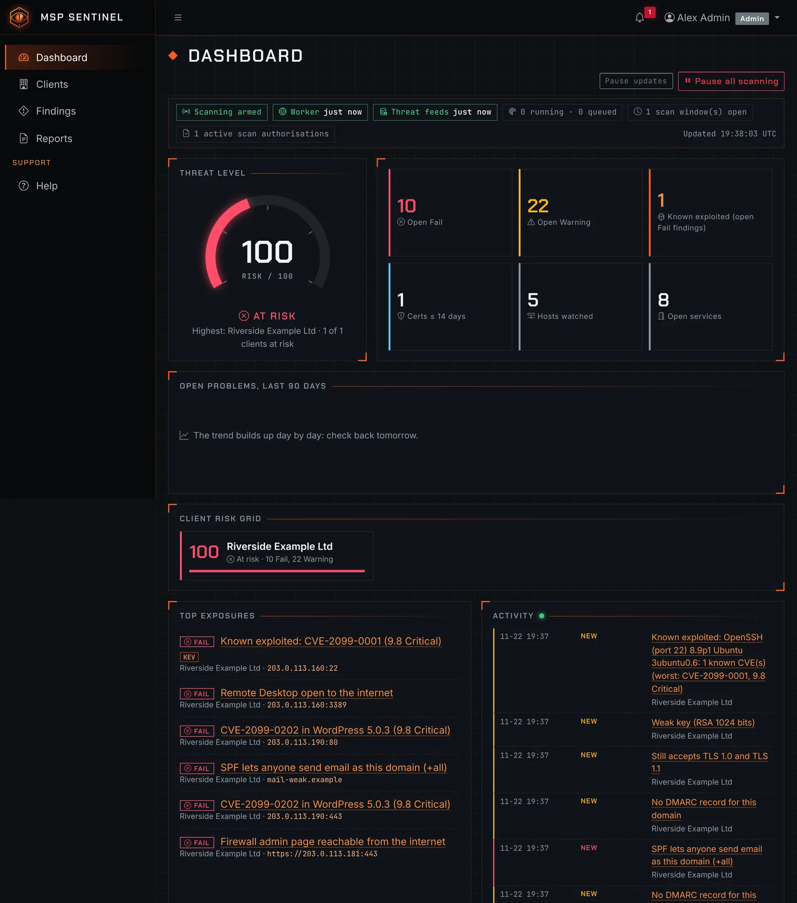

<div align="center">


# MSP Sentinel

**Self-hosted security monitoring for MSPs.** Find what attackers can see and reach, across every client,
inside and outside the network, and get it fixed on time.


[Features](#features) · [Screenshots](#screenshots) · [How it stays safe](#how-it-stays-safe) · [Install](#install) ·
[Documentation](#documentation) · [What's new](#whats-new)

</div>

<p align="center"></p>

## What it is

MSP Sentinel is a security product an MSP runs on its own server and brands as its own. It finds what attackers can
see and reach at each client, from the internet and inside the network, alerts on it, and tracks the fixes until a
check proves them. Its companion product, **MSP Align**, plans, reports and proves, using Sentinel's findings.

## Features

- **External exposure:** forgotten hostnames (DNS, certificate logs), gentle port scans, exposed admin pages, VPN
  portals and remote access, TLS certificates.
- **Website and email:** HTTPS and security headers, cookies, exposed `.git`/`.env`/backups, CMS versions, SPF, DMARC
  and DKIM, DNS zone transfers and subdomain takeover.
- **Vulnerabilities:** matched with NVD, CISA's known-exploited list (KEV) and EPSS; "confirmed" and "possible" kept
  apart, versions never guessed.
- **Inside the network:** an outbound-only on-premises agent finds devices, services, certificates, risky protocols
  and Active Directory weaknesses; NinjaOne adds installed software, updates, antivirus and encryption.
- **Breached accounts:** weekly check of your clients' domains against known data breaches.
- **Fix workflow:** triage, owners, due dates, daily reminders and *verify fix* rechecks of one finding.
- **Pen-test engagements:** time-boxed deeper tests, approved by a second admin, with a report and a retest letter.
- **Alerts and reports:** bell, email and Teams/Slack; branded executive and technical reports, frozen with a SHA-256.
- **Integrations:** ITFlow (clients and tickets), MSP Align (compliance), NinjaOne (devices), API and signed events.
- **Operations:** one-command installer, Update now, encrypted backups, health checks, audit log.

## Screenshots

<table>
  <tr>
    <td width="50%"><br><sub><b>Client overview</b> (light theme): risk score, findings, attack surface.</sub></td>
    <td width="50%"><br><sub><b>Findings</b>: owners, due dates, overdue and due-soon quick links.</sub></td>
  </tr>
  <tr>
    <td><br><sub><b>A finding</b>: owner, due date, <i>verify fix</i> and full history.</sub></td>
    <td><br><sub><b>Website and email</b>: headers, exposed files, CMS versions, SPF/DMARC/DKIM.</sub></td>
  </tr>
  <tr>
    <td><br><sub><b>On-premises agents</b>: signed internal authorisation, check-ins, kill switch.</sub></td>
    <td><br><sub><b>Internal device</b>: open services, certificates, software and findings.</sub></td>
  </tr>
  <tr>
    <td><br><sub><b>Executive report</b>: branded, plain English, frozen with a SHA-256.</sub></td>
    <td><br><sub><b>Sign-in</b>: two-factor authentication is mandatory.</sub></td>
  </tr>
</table>

All screenshots use made-up clients and documentation addresses only.

## How it stays safe

- **Authorised targets only.** Nothing is scanned unless the client approved it in writing and you recorded it.
  Scope is checked again at the moment of scanning, and every active scan is logged.
- **Gentle by default.** Slow, rate-limited scans inside each client's scan window, with a global kill switch and a
  pause per client and per site.
- **Signed agent jobs.** Agents scan only the networks approved for their site, checked against a signature that the
  database alone can't forge.
- **Locked-down sign-in.** Mandatory two-factor authentication, three roles, your own password for powerful actions,
  secrets encrypted at rest.

More in [docs/security.md](docs/security.md) and [docs/responsible-use.md](docs/responsible-use.md). Sentinel is
**not a PCI ASV scan** and not a substitute for an independent penetration test.

## Install

One line on a fresh **Debian 13** VM (Debian 12 and Ubuntu 24.04 also work):

```sh
curl -fsSL https://raw.githubusercontent.com/MSP-ALIGN/MSP-Sentinel/main/install.sh | sudo -E bash
```

A guided install asks seven questions (host name, HTTPS, firewall, fail2ban, automatic updates, backup passphrase,
first admin), shows a summary, then sets up Nginx, PHP 8.4, MariaDB, nmap, cron jobs and HTTPS. Upgrade later with
**Update now** under Administration → System, or `sudo msp-sentinel-update`.

Requirements, a development server, unattended installs and signed release archives: see
[docs/install.md](docs/install.md). Agents for client sites: see [docs/guides/agents.md](docs/guides/agents.md).

## Documentation

**New here? [Start here](docs/README.md)**: your first day, step by step.

| Guide | |
|---|---|
| [Your first client](docs/guides/first-client.md) | Add a client, record the authorisation, run the first scan |
| [Findings](docs/guides/findings.md) | Read, triage and fix findings; owners, due dates, verify fix |
| [Search](docs/guides/search.md) | The top-bar search and the filters |
| [Reports](docs/guides/reports.md) | Executive and technical reports, monthly reports, PDF and CSV |
| [Pen-test engagements](docs/guides/engagements.md) | Create, approve, run and report a deeper test |
| [On-premises agents](docs/guides/agents.md) | Scan inside a client's network; Active Directory checks |
| [Integrations](docs/guides/integrations.md) | ITFlow, MSP Align, NinjaOne, breach monitoring, API |
| [Alerts](docs/guides/alerts.md) | Email, Teams/Slack, notifications, fix reminders |
| [Users and security](docs/guides/users-and-security.md) | Roles, two-factor sign-in, users, API tokens, audit log |
| [Running the server](docs/guides/admin-system.md) | System page, updates, backups, retention, demo data |

Reference: [install](docs/install.md), [configuration](docs/configuration.md), [upgrade](docs/upgrade.md),
[backup](docs/backup.md), [operations](docs/operations.md), [API](docs/api.md) and more in
[docs/README.md](docs/README.md#reference). The same help is built into the app (**Help** in the menu).

## What's new

### 1.35.1 (2026-11-24): update hardening, fixes from review

- **Windows: no new code as SYSTEM during an update either.** The update task's pre-flight used to run the new
  release's self-check as SYSTEM; it now asks PHP for its version and extensions with its own fixed code.
- **Giving agents a replaced release key needs no installed code:** `echo NEWKEY | sudo tee
  /etc/sentinel-agent/release-key.pub`. The installed copy of `agent-install.sh` refuses `--upgrade` (it is code a
  remote update delivered); upgrade from a downloaded, checked release.
- **The change-over to the frozen helper has a limit:** the update from 1.34 or older is still installed by the old
  helper, so the protection starts with the next update. Upgrade agents to 1.35 by hand once where that matters.
- **Smaller fixes:**
  - a Windows launcher that can't be swapped, or an update folder that can't be prepared, is logged in `update\task.log`;
  - half-made frozen copies are cleaned up;
  - `release-sign.php hash --ref` reads files without line-ending conversion and refuses an empty `--ref`;
  - `SHA256SUMS` now covers `AGENT-MANIFEST-SHA256`;
  - the docs say signing off the server is the strongest option.

### 1.35.0 (2026-11-24): agent updates can't run new code as root; signing checks the release hash

- **The agent update helper is frozen.** Linux agents run the root update helper from a root-owned copy in
  `/usr/local/lib/sentinel-agent-update`, and Windows agents run the SYSTEM update task from `updater\`, both outside
  the code folder that updates replace. A remote update no longer rewrites the systemd units either. So code from a new
  release only ever runs as the agent's unprivileged account, even if a release were signed through a compromised
  Sentinel.
  - Nothing to do: an agent makes its frozen copy at its next update, from the version it already runs. The installers
    refresh it on install and on a manual upgrade. On Windows, if the old launcher can't be swapped while it runs,
    `install-agent.ps1 -Upgrade` once finishes the change.
  - From now on, changes to the helper or the services arrive only with a manual upgrade; release notes will say so.
- **Signing a version checks its hash.** On **Administration → System → Sign this version**, paste the expected
  manifest SHA-256 from the release notes, or compute it on your own computer with
  `php bin/release-sign.php hash --ref vX.Y.Z` (no key needed). Your browser signs only if the files it is about to
  sign match; Sentinel checks again and records the hash in the audit log. Each release build now publishes
  `AGENT-MANIFEST-SHA256` next to `SHA256SUMS`.

### 1.34.0 (2026-11-24): security audit, search, confirmations, easier workflows and docs

- **Search.** A search box in the top bar finds clients, findings (title, target or CVE), external hosts, internal
  devices, engagements and help topics. Findings and the audit log get a "Contains" filter; Clients, Users, Devices,
  Engagements and Help get instant filter boxes.
- **"Are you sure?"** An in-page dialog says exactly what will happen before destructive, outbound or costly actions
  (deleting or revoking, sending tests, starting scans or rechecks, approving engagements, bulk triage).
- **Security audit fixes:**
  - Two-person approval of engagements can't be bypassed with an account the creator made or reset (30 days).
  - Creating a user, resetting a password or 2FA, changing a role or access, and creating API tokens ask for your own
    password. Engagement approval also refuses accounts linked to the creator the other way round or through a chain.
  - Changing the ITFlow or MSP Align address, or the SMTP host, clears the saved key or password.
  - Technicians' verify-fix rechecks wait for the scan window (admins' run straight away).
  - Encrypted settings and 2FA seeds are bound to their place; migration 0042 upgrades stored values.
  - Agents send the Active Directory password only to the domain and domain controller address they first signed in
    to (`dc-pins.json` on the agent; delete it there if the domain controller really moves).
  - Restoring a backup can't run client commands from a tampered dump, and keeps this server's program and folder
    settings; the backup passphrase file is owner-only.
  - Wildcards under shared platforms (`*.s3.amazonaws.com` and similar) are refused in the scan register. Entries
    saved before are not re-checked: look through your registers for such wildcards.
  - An enrolment code needs the site's internal authorisation first.
  - MSP Align links must be web addresses; Teams alert text can't add links or formatting.
  - Alerts are sent while a long scan runs; API lockouts are audited; notifications are marked read only on request.
  - The Update now card shows the installed and newest commit (branch code is unsigned).
- **Easier workflows:**
  - New engagements start with the gentle pace and without the all-ports test (the least risky choice).
  - Engagement approvals: other admins are notified, the dashboard shows what awaits you, and a new Engagements page
    lists every engagement. A lone admin is told to add a second one.
  - Finding pages show "Why it matters / How to fix".
  - Reports can be created from the Reports page.
  - First run: buttons to add a client and record its authorisation, "Not scanned yet" instead of a perfect score,
    clearer next steps and messages.
  - Readable evidence in client reports, an API reference page for admins, readable audit log rows, owner names in
    pickers, a type-to-search time zone field.
  - Opening a form's address as a page goes to the page that holds the form.
  - Phones: tables scroll inside their cards and the findings filters fold away.
- **Documentation:** task-based guides with a "Start here" page on GitHub, and in-app help reorganised the same way.

Older releases: [release history](docs/whats-new.md). Every change: [CHANGELOG.md](CHANGELOG.md).

## Contributing

Contributions are welcome; see [CONTRIBUTING.md](CONTRIBUTING.md). Commits carry a DCO sign-off (`git commit -s`).

## Tests

The end-to-end suite creates a throwaway database, starts PHP's built-in web server on `127.0.0.1` and drives the
real application. It never contacts any other host, and it uses only made-up data.

```sh
php tests/run.php            # all tests
php tests/run.php users      # only tests whose name contains "users"
```

The database admin used to create and drop the test database is set with `SENTINEL_TEST_DB_ADMIN_DSN`,
`SENTINEL_TEST_DB_ADMIN_USER` and `SENTINEL_TEST_DB_ADMIN_PASS`. By default it uses `root` over the local socket.

## Project layout

| Path | What |
|---|---|
| `public/` | Web root: front controller and static assets (Bootstrap 5.3, AdminLTE 4 and Bootstrap Icons, all served locally) |
| `src/` | Application code (`Core`, `Auth`, `Scope`, `Discovery`, `Scanning`, `Web`, `Vulns`, `Findings`, `Inventory`, `Agent`, `AgentClient`, `Alerts`, `Reports`, `Dashboard`, `Api`, `System`, `Controllers`) |
| `views/` | PHP templates (every value is escaped with `e()`) |
| `migrations/` | Idempotent database migrations |
| `bin/` | CLI tools, including the on-premises agent (`sentinel-agent.php`) and demo data (`demo.php`) |
| `lang/` | Interface translations (English is the source language) |
| `help/` | In-app help and "What's new" entries |
| `tests/` | End-to-end and unit tests |
| `docs/` | Guides, design, roadmap and README screenshots (`docs/images/`) |
| `install/` | Server and agent installers, and config templates |

## Security

Please report vulnerabilities privately. See [SECURITY.md](SECURITY.md).

## Third-party components

Served from `public/assets/vendor/`, each with its licence file: Bootstrap 5.3.8 (MIT), AdminLTE 4.10.0 (MIT),
Bootstrap Icons 1.13.1 (MIT), qrcode-generator 2.0.4 (MIT, licence notice in the file header), and the fonts
Chakra Petch and JetBrains Mono (SIL Open Font License 1.1, licence files in `public/assets/vendor/fonts/`).
