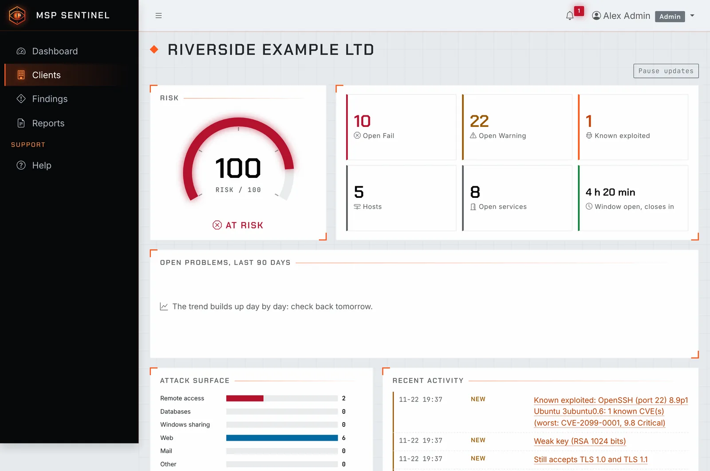
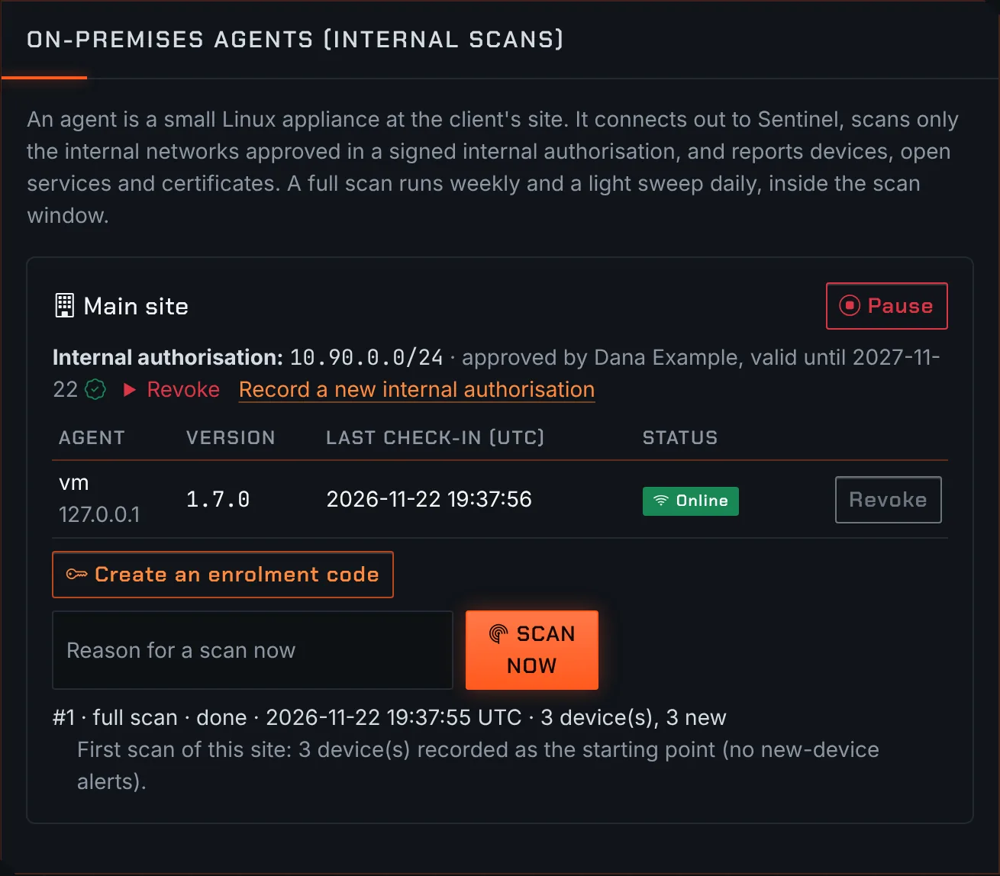

<div align="center">


# MSP Sentinel

**Self-hosted security monitoring for MSPs.** Find what attackers can see and reach, across every client,
inside and outside the network, and get it fixed on time.


[Features](#features) · [Screenshots](#screenshots) · [How it stays safe](#how-it-stays-safe) · [Install](#install) ·
[Documentation](#documentation) · [What's new](#whats-new)

</div>

<p align="center"></p>

## What it is

MSP Sentinel is a security product an MSP runs on its own server and brands as its own. It **detects**: it finds
external exposure and vulnerabilities across your clients, watches them, alerts on them, and tracks the fixes. Its
companion product, **MSP Align**, plans, reports and proves, using Sentinel's findings.

- **Authorised targets only.** Nothing is scanned unless a client approved it in writing and you recorded it in
  Sentinel's "authorised to scan" register. Every active scan is logged.
- **Gentle by default.** Slow, rate-limited TCP connect scans inside each client's scan window, with kill switches.
- **Honest findings.** Versions are never guessed; "confirmed" and "possible" are kept apart; nothing is called fixed
  unless a check proved it.
- **Your data stays yours.** Self-hosted, white-label reports, free software under the AGPL-3.0.

## Features

| | |
|---|---|
| **External exposure** | Passive discovery of forgotten hostnames (DNS, certificate logs), gentle port scans, exposed admin pages, VPN portals and remote access, TLS certificate checks |
| **Website and email** | HTTPS and security headers, cookies, exposed `.git`/`.env`/backups (proved by content), CMS and JavaScript library versions, SPF, DMARC and DKIM |
| **Vulnerabilities** | Matched with NVD, CISA's known-exploited list (KEV) and EPSS; "confirmed" for exact versions, distribution builds and unknown versions treated honestly |
| **Inside the network** | On-premises agent (Linux appliance, outbound only, signed scope): devices, services, certificates, new-device alerts, and risky protocols (SMBv1, SMB signing, RDP without NLA, default SNMP, Telnet, FTP) |
| **Internal devices** | Groundwork for NinjaOne: installed software matched to CVEs, unsupported Windows, antivirus, disk encryption and missing updates (connector coming) |
| **Fix workflow** | Triage (accepted risk, false positive), owners, due dates by severity, overdue reminders, and *verify fix* rechecks of a single finding |
| **Alerts** | In-app bell, email and Teams/Slack webhooks; immediate alerts for new Fails, digests, daily reminders |
| **Reports** | Branded executive and technical reports with plain-English fixes, frozen with a SHA-256, monthly email schedule, CSV export |
| **Dashboards** | Command-view dashboard with a 0–100 risk score per client, trends, attack surface and live activity |
| **API** | Read and (opt-in) write API with scoped, expiring tokens, plus signed outbound events |
| **Operations** | One-command installer, encrypted backups, health checks, update check, data retention, audit log |

## Screenshots

<table>
  <tr>
    <td width="50%"><br><sub><b>Client overview</b> (light theme): risk score, findings, attack surface.</sub></td>
    <td width="50%"><br><sub><b>Findings</b>: owners, due dates, overdue and due-soon quick links.</sub></td>
  </tr>
  <tr>
    <td><br><sub><b>A finding</b>: owner, due date, <i>verify fix</i> and full history.</sub></td>
    <td><br><sub><b>Website and email</b>: headers, exposed files, CMS versions, SPF/DMARC/DKIM.</sub></td>
  </tr>
  <tr>
    <td><br><sub><b>On-premises agents</b>: signed internal authorisation, check-ins, kill switch.</sub></td>
    <td><br><sub><b>Internal device</b>: open services, certificates, software and findings.</sub></td>
  </tr>
  <tr>
    <td><br><sub><b>Executive report</b>: branded, plain English, frozen with a SHA-256.</sub></td>
    <td><br><sub><b>Sign-in</b>: two-factor authentication is mandatory.</sub></td>
  </tr>
</table>

All screenshots use made-up clients and documentation addresses only.

## How it stays safe

- **Scope is enforced at the moment of scanning**, against an active, approved authorisation, with a global kill
  switch and a pause per client and per site.
- **Agents scan only what was approved for their site**: internal authorisations and every job are signed with a key
  that is not in the database, and the agent checks the signatures and its own site before it touches anything.
- **Sign-in** with mandatory TOTP two-factor authentication, three roles, CSRF protection on every form, a strict
  Content Security Policy, and everything escaped on output.
- **Secrets** are encrypted with libsodium; tokens and recovery codes are stored only as keyed hashes.
- **Outbound requests** are pinned and never follow redirects; **reports** run no scripts.

More in [docs/security.md](docs/security.md), [docs/agent.md](docs/agent.md) and
[docs/responsible-use.md](docs/responsible-use.md). Sentinel is **not a PCI ASV scan** and not a penetration test.

## Install

One line on a fresh **Debian 13** VM (Debian 12 and Ubuntu 24.04 also work):

```sh
curl -fsSL https://raw.githubusercontent.com/MSP-ALIGN/MSP-Sentinel/main/install.sh | sudo -E bash
```

A guided install walks you through seven steps and shows a summary before it changes anything:

1. Host name
2. HTTPS: Let's Encrypt, self-signed, or behind your reverse proxy
3. Firewall (ufw)
4. fail2ban
5. Automatic security updates
6. Backup encryption passphrase
7. First admin

It then sets up Nginx, PHP-FPM 8.4, MariaDB, the database, a fresh app key, cron jobs, HTTPS and log rotation. Upgrade later with
`sudo msp-sentinel-update`, or with **Update now** under Administration → System. The step-by-step guide, unattended installs and signed release archives: see [docs/install.md](docs/install.md).

A development server that follows the `develop` branch, to try changes before production (marked
**Development build** in the web interface):

```sh
curl -fsSL https://raw.githubusercontent.com/MSP-ALIGN/MSP-Sentinel/develop/install-dev.sh | sudo -E bash
```

For an on-premises agent at a client site (asks for the Sentinel address and the one-time code):

```sh
curl -fsSL https://raw.githubusercontent.com/MSP-ALIGN/MSP-Sentinel/main/install-agent.sh | sudo -E bash
```

### Requirements

- PHP 8.4 (8.3 works), with the extensions `pdo_mysql`, `sodium`, `mbstring`, `openssl`, `curl`, `simplexml` and `gd`
- MariaDB 10.6 or newer
- **nmap** 7.x for port scanning (`apt install nmap`). It is not bundled; its licence is the NPSL.
- A web server that sends requests to `public/index.php` (Apache with the included `.htaccess`, nginx, or similar)
- HTTPS in production

## Documentation

| Guide | |
|---|---|
| [User guide](docs/user-guide.md) | Roles, the client workflow, grades, fix workflow |
| [Install](docs/install.md) | Installer, what it sets up, manual install on other systems |
| [Upgrade](docs/upgrade.md) | `install.sh --upgrade`, manual upgrades, rolling back by hand |
| [Configuration](docs/configuration.md) | Every `config/config.php` option and environment variable |
| [On-premises agent](docs/agent.md) | Safety model, schedule, install, operations, what is graded |
| [Security](docs/security.md) | What Sentinel protects, and your hardening checklist |
| [Responsible use](docs/responsible-use.md) | Authorisation, gentle scanning, honest reporting |
| [Authorisation form](docs/authorisation-form.md) | A template for the client's written approval |
| [Backup and restore](docs/backup.md) | Daily encrypted backups, restore, moving servers |
| [Operations](docs/operations.md) | Cron jobs, health checks, logs, retention, troubleshooting |
| [API](docs/api.md) | Tokens, endpoints, signed outbound events |
| [Design](docs/DESIGN.md) and [Roadmap](docs/ROADMAP.md) | How it is built, and what is next |

The same help is built into the app (**Help** in the menu), with a "What's new" page for every release.

## What's new

### 1.13.0 (2026-11-22): client pages

- Opening a client now switches the left menu to **that client's own menu**: Overview, Findings, External (scans and
  ports, vulnerabilities, certificates and web, website and email), Internal (agents, devices) and Manage
  (authorisations, discovery, reports), with **All clients** to go back. No more one long page.
- Each section is its own page with its own address (for example `/clients/12/devices`), and only loads what it shows.
- The client's forms and device pages keep the client menu; actions return you to the page you were on.

### 1.12.1 (2026-11-22): one-click Update now

- **Update now** is a one-click admin action again (with an "Are you sure?" prompt): no password or 2FA code. The
  server still only runs the normal update (backup first), at most once every 15 minutes, and every request is in
  the audit log.

<details>
<summary><b>Earlier releases (1.12.0 to 1.0.0)</b></summary>

### 1.12.0 (2026-11-22): update from the web interface

- **Update now** under **Administration → System**, on development and production servers installed with the
  one-line command. It asks for your password and a 2FA code, then runs the same `msp-sentinel-update` as on the
  server (backup first, fetch, database changes, health check) and shows its progress and output.
- The web app still runs without privileges: it only leaves an empty request file, and a small root-owned systemd
  service on the server runs the fixed update command. Admin-only, rate-limited and audited. Turn it off on the
  server with one command (see [docs/upgrade.md](docs/upgrade.md#from-the-web-interface)).
- **Update available** notice: servers that follow a branch see how many new commits it has since their install
  (part of the daily update check, or **Check now**).
- Existing servers get both with their next `sudo msp-sentinel-update`.

### 1.11.0 (2026-11-22): demo data

- **Demo data** for trying Sentinel out, testing or training: four made-up clients with findings of every kind
  (open, assigned, overdue, accepted, false positive and fixed), an on-premises agent with devices and risky
  protocols, inventory devices with patches and installed software, scan history, 90 days of trends and two reports.
- Load or remove it under **Administration → System → Demo data**, or on the server with
  `sudo -u sentinel php /opt/msp-sentinel/bin/demo.php --load` (`--remove`, `--status`).
- **Demo clients are never scanned.** They use `*.example` names and documentation-only addresses, carry a Demo
  badge, and every scan path refuses them: scheduled and manual scans, verify fix, discovery, agent jobs, inventory
  sync and vulnerability look-ups. Removing demo data deletes only demo clients and what belongs to them.

### 1.10.0 (2026-11-22): development servers

- **One-line install for a development server** that follows the `develop` branch, so changes can be tried before
  they reach production:
  `curl -fsSL https://raw.githubusercontent.com/MSP-ALIGN/MSP-Sentinel/develop/install-dev.sh | sudo -E bash`.
  `sudo msp-sentinel-update` keeps it on `develop`.
- Development servers show a **Development build** badge on every page. Administration → System shows the branch
  and commit of every install made with the one-line installer.
- See "Development server" in [docs/install.md](docs/install.md).

### 1.9.0 (2026-11-22): guided install

- The one-line install is now a **seven-step guided install** with a summary to confirm before anything changes:
  host name, HTTPS, firewall, fail2ban, automatic security updates, backup encryption and the first admin.
- **Three HTTPS choices:** Let's Encrypt, self-signed, or **behind a reverse proxy** (Sentinel listens on plain HTTP
  for the proxy's address only and trusts its forwarded headers).
- **Server hardening by default:** ufw firewall (SSH rate-limited), fail2ban for SSH, and Debian's automatic security
  updates. Each can be turned off.
- **Encrypted backups from day one:** set a backup passphrase during install.
- Every answer can also be given as a `SENTINEL_*` environment variable for unattended installs. New installer
  options: `--tls`, `--proxy-ip`, `--no-firewall`, `--no-fail2ban`, `--no-auto-updates`.
- Step-by-step guide in [docs/install.md](docs/install.md).

### 1.8.0 (2026-11-22): one-line install on Debian 13

- **One-line install** on a fresh Debian 13 VM:
  `curl -fsSL https://raw.githubusercontent.com/MSP-ALIGN/MSP-Sentinel/main/install.sh | sudo -E bash`. It asks for the
  host name, certificate and first admin (or takes them from environment variables for unattended installs), and adds
  `sudo msp-sentinel-update` for upgrades.
- The same for on-premises agents: `install-agent.sh`, with `sudo msp-sentinel-agent-update`.
- **Debian 13** is now the recommended system (it ships PHP 8.4, so no extra package source is needed). Debian 12 and
  Ubuntu 24.04 still work.
- The installers ask their questions on the terminal, so they also work when piped from `curl`.

### 1.7.0 (2026-11-22): risky internal protocols

- The on-premises agent now checks each device of a full scan for risky protocols, read-only:
  - **Fail:** SMBv1 enabled, Telnet open, SNMP answering the default "private" community.
  - **Warning:** SMB signing not required, Remote Desktop without Network Level Authentication, FTP open, SNMP
    answering "public", login pages over plain HTTP.
- No logins: SMB and RDP are read from the protocol negotiation. The SNMP check sends one read request with the
  default community names. A check that can't decide is never a finding.
- Plain-English explanations and fixes in reports; findings show on the device page.

### 1.6.0 (2026-11-22): on-premises agents

- **Internal scans** from a small Linux appliance at the client's site (Ubuntu 24.04 or Debian 12). The agent only
  connects out to Sentinel. Weekly full scans (devices, open services and versions, certificates, start pages) and
  daily light sweeps, inside the scan window; admins can scan now with a reason.
- **Signed scope:** each site gets an internal authorisation (private networks only, size-limited) that Sentinel
  signs with a key outside the database. Every job is signed too; the agent checks both signatures and refuses any
  target outside the signed networks. Results outside the authorisation are ignored.
- **Findings:** vulnerable services (distribution builds never "confirmed"), and certificates that are expired,
  accept TLS 1.0/1.1 or use a weak key. **New-device alerts** after a site's first (baseline) scan, unless NinjaOne
  already knows the device.
- **Control:** one-time enrolment codes, revocable agents, a kill switch per site, and an installer with a hardened,
  unprivileged systemd service. See [`docs/agent.md`](docs/agent.md).
- **Internal devices groundwork** for NinjaOne: installed software matched to vulnerabilities (one finding per device
  and program), unsupported Windows versions, antivirus, disk encryption and missing updates, with an Internet /
  Internal filter on the findings list. The NinjaOne connector itself follows in a later release.

### 1.5.0 (2026-11-22): fix workflow

- **Owners:** technicians and admins assign findings to an active technician or admin ("Assign to me" for yourself).
  The new owner gets a notification and an email. Viewers see owners but can't change them.
- **Due dates** for every open finding: known-exploited 7 days, other Fail 14 days, Warnings 30 days, counted from when
  it was first seen or reopened. Admins change the days in Settings, or set one finding's date with a reason.
  Accepted risks and false positives are never due.
- **Overdue at a glance:** overdue and due-soon badges, owner and due filters, and quick links ("Assigned to me",
  "Unassigned", "Overdue", "Due within 2 days").
- **Daily reminders** after 07:00 UTC: each owner's overdue and due-soon findings (one note and one email), and an
  overdue summary per client for the team addresses and webhook.
- **Verify fix:** recheck one finding straight away (one address and port, or one domain's email records), also
  outside the scan window, only while it is in scope and scanning isn't paused. Once every 10 minutes per finding.
  Resolves the finding when the problem is gone.
- The API returns each finding's owner and due date.

### 1.4.0 (2026-11-22): website and email security

- **Website checks** run with each port scan and once a day: HTTP to HTTPS redirects, logins served without
  encryption, security headers (HSTS, Content-Security-Policy and others), cookie flags and directory listings.
- **Exposed files**: a short fixed list of paths (/.git/HEAD, /.env, backups and database dumps, /phpinfo.php,
  /server-status, /.DS_Store). A file is only reported when its content proves it, so sites that answer every address
  with a page aren't flagged. File contents are never stored.
- **CMS and libraries**: WordPress, Drupal, Joomla, jQuery, Bootstrap, AngularJS, Lodash, Moment.js and Vue.js are
  recognised from page markup; visible versions are matched to known vulnerabilities (confirmed), and unknown
  versions only to known-exploited ones (possible).
- **Email security**: SPF, DMARC and DKIM (common selectors) for each authorised domain that receives email, by DNS
  only. A new **Email security** finding type.
- A **Website and email security** card on the client page, and plain-English explanations and fixes in reports.

### 1.3.0 (2026-11-22): Administration as its own section

- The left menu now holds only day-to-day work: Dashboard, Clients, Findings, Reports and Help.
- **Administration** moved to the user drop-down (top right) for admins: Overview, Users, Settings, API, System and
  Audit log. Admin pages have their own left menu, clearly marked, with a "Back to Sentinel" link.
- A new **Administration overview** shows each area with its key status: active users, email and webhook,
  API tokens and events, system health and updates, and recent audit activity.

### 1.2.0 (2026-11-22): command-view dashboards

- The **dashboard** is now a command view: a threat-level gauge (the highest client risk), totals, a 90-day trend,
  every client ranked by risk, the worst open findings, a live activity feed, the attack surface by type of service,
  certificates expiring in the next 30 days, and an operations strip (scanning armed or paused, worker, threat
  feeds, scans running, scan windows, authorisations).
- Every **client page** opens with its own overview console: risk gauge, totals, a scan-window countdown, trend,
  attack surface, recent activity and expiring certificates.
- A simple **risk score** (0-100, higher is worse): 20 per open known-exploited Fail, 10 per other Fail, 2 per
  Warning, capped at 100. The formula is in Help.
- Dashboards **refresh every minute** while visible, from Sentinel's own server only.
- Charts are drawn on the server as SVG with text labels; severity still comes with icons and words.

### 1.1.0 (2026-11-22): console look and new logo

- A new **dark "operations console" look** for the web interface: near-black panels with ember accents, angular
  cards, a subtle grid, uppercase headings in Chakra Petch and data in JetBrains Mono (both bundled locally under
  the SIL Open Font License, so nothing loads from other sites).
- A new **logo**: an original "radar iris" eye in a hexagon, used in the menu, on the sign-in page and as the
  browser icon. Its radar sweep is still for anyone who prefers reduced motion.
- **Dark by default, light per user:** choose under My profile → Appearance.
- Severity still never relies on colour alone, and client reports keep their clean, printable, MSP-branded style.

### 1.0.0 (2026-11-22): first stable release

- **Ready for other MSPs to install:** a release archive with checksums, and an installer for Ubuntu 24.04 and
  Debian 12 (Nginx, PHP-FPM 8.4, MariaDB, Let's Encrypt or self-signed HTTPS, cron, log rotation) with `--upgrade`
  and `--dry-run`.
- **Health check:** Administration → System and `bin/doctor.php` check PHP, the database, migrations, nmap, the
  worker, the feeds, storage, HTTPS, email and updates.
- **Backup and restore:** `bin/backup.php` (database, config and logo; optional passphrase encryption; keeps the
  newest N) and `bin/restore.php` (checks every file against its manifest first; dry run unless `--yes`). The installer sets up daily
  backups.
- **Update check:** once a day the worker asks the releases feed for the latest version; admins can turn it off.
- **Data retention:** choose how many months to keep scan history, resolved findings and reports. The audit log is
  always kept.
- **Documentation** in `docs/`: install, upgrade, configuration, security, backup, operations, API and a user guide.
  The full history is in [CHANGELOG.md](CHANGELOG.md).

</details>

Full history: [CHANGELOG.md](CHANGELOG.md).

## Contributing

Contributions are welcome; see [CONTRIBUTING.md](CONTRIBUTING.md). Commits carry a DCO sign-off (`git commit -s`).

## Tests

The end-to-end suite creates a throwaway database, starts PHP's built-in web server on `127.0.0.1` and drives the
real application. It never contacts any other host, and it uses only made-up data.

```sh
php tests/run.php            # all tests
php tests/run.php users      # only tests whose name contains "users"
```

The database admin used to create and drop the test database is set with `SENTINEL_TEST_DB_ADMIN_DSN`,
`SENTINEL_TEST_DB_ADMIN_USER` and `SENTINEL_TEST_DB_ADMIN_PASS`. By default it uses `root` over the local socket.

## Project layout

| Path | What |
|---|---|
| `public/` | Web root: front controller and static assets (Bootstrap 5.3, AdminLTE 4 and Bootstrap Icons, all served locally) |
| `src/` | Application code (`Core`, `Auth`, `Scope`, `Discovery`, `Scanning`, `Web`, `Vulns`, `Findings`, `Inventory`, `Agent`, `AgentClient`, `Alerts`, `Reports`, `Dashboard`, `Api`, `System`, `Controllers`) |
| `views/` | PHP templates (every value is escaped with `e()`) |
| `migrations/` | Idempotent database migrations |
| `bin/` | CLI tools, including the on-premises agent (`sentinel-agent.php`) and demo data (`demo.php`) |
| `lang/` | Interface translations (English is the source language) |
| `help/` | In-app help and "What's new" entries |
| `tests/` | End-to-end and unit tests |
| `docs/` | Guides, design, roadmap and README screenshots (`docs/images/`) |
| `install/` | Server and agent installers, and config templates |

## Security

Please report vulnerabilities privately. See [SECURITY.md](SECURITY.md).

## Third-party components

Served from `public/assets/vendor/`, each with its licence file: Bootstrap 5.3.8 (MIT), AdminLTE 4.10.0 (MIT),
Bootstrap Icons 1.13.1 (MIT), qrcode-generator 2.0.4 (MIT, licence notice in the file header), and the fonts
Chakra Petch and JetBrains Mono (SIL Open Font License 1.1, licence files in `public/assets/vendor/fonts/`).
