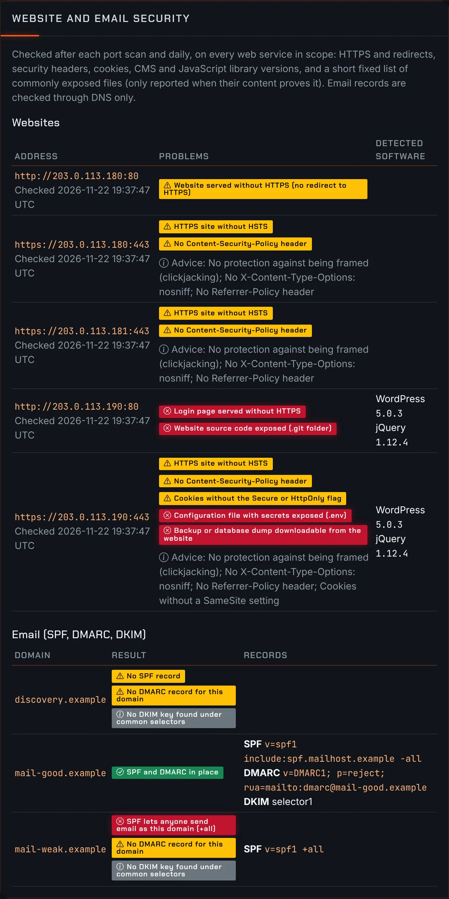

<div align="center">


# MSP Sentinel

**Self-hosted security monitoring for MSPs.** Find what attackers can see and reach, across every client,
inside and outside the network, and get it fixed on time.


[Features](#features) · [Screenshots](#screenshots) · [How it stays safe](#how-it-stays-safe) · [Install](#install) ·
[Documentation](#documentation) · [What's new](#whats-new)

</div>

<p align="center"></p>

## What it is

MSP Sentinel is a security product an MSP runs on its own server and brands as its own. It finds what attackers can
see and reach at each client, from the internet and inside the network, alerts on it, and tracks the fixes until a
check proves them. Its companion product, **MSP Align**, plans, reports and proves, using Sentinel's findings.

## Features

- **External exposure:** forgotten hostnames (DNS, certificate logs), gentle port scans, exposed admin pages, VPN
  portals and remote access, TLS certificates.
- **Website and email:** HTTPS and security headers, cookies, exposed `.git`/`.env`/backups, CMS versions, SPF, DMARC
  and DKIM, DNS zone transfers and subdomain takeover.
- **Vulnerabilities:** matched with NVD, CISA's known-exploited list (KEV) and EPSS; "confirmed" and "possible" kept
  apart, versions never guessed.
- **Inside the network:** an outbound-only on-premises agent finds devices, services, certificates, risky protocols
  and Active Directory weaknesses; NinjaOne adds installed software, updates, antivirus and encryption.
- **Breached accounts:** weekly check of your clients' domains against known data breaches.
- **Fix workflow:** triage, owners, due dates, daily reminders and *verify fix* rechecks of one finding.
- **Pen-test engagements:** time-boxed deeper tests, approved by a second admin, with a report and a retest letter.
- **Alerts and reports:** bell, email and Teams/Slack; branded executive and technical reports, frozen with a SHA-256.
- **Integrations:** ITFlow (clients and tickets), MSP Align (compliance), NinjaOne (devices), API and signed events.
- **Operations:** one-command installer, Update now, encrypted backups, health checks, audit log.

## Screenshots

<table>
  <tr>
    <td width="50%"><br><sub><b>Client overview</b> (light theme): risk score, findings, attack surface.</sub></td>
    <td width="50%"><br><sub><b>Findings</b>: owners, due dates, overdue and due-soon quick links.</sub></td>
  </tr>
  <tr>
    <td><br><sub><b>A finding</b>: owner, due date, <i>verify fix</i> and full history.</sub></td>
    <td><br><sub><b>Website and email</b>: headers, exposed files, CMS versions, SPF/DMARC/DKIM.</sub></td>
  </tr>
  <tr>
    <td><br><sub><b>On-premises agents</b>: signed internal authorisation, check-ins, kill switch.</sub></td>
    <td><br><sub><b>Internal device</b>: open services, certificates, software and findings.</sub></td>
  </tr>
  <tr>
    <td><br><sub><b>Executive report</b>: branded, plain English, frozen with a SHA-256.</sub></td>
    <td><br><sub><b>Sign-in</b>: two-factor authentication is mandatory.</sub></td>
  </tr>
</table>

All screenshots use made-up clients and documentation addresses only.

## How it stays safe

- **Authorised targets only.** Nothing is scanned unless the client approved it in writing and you recorded it.
  Scope is checked again at the moment of scanning, and every active scan is logged.
- **Gentle by default.** Slow, rate-limited scans inside each client's scan window, with a global kill switch and a
  pause per client and per site.
- **Signed agent jobs.** Agents scan only the networks approved for their site, checked against a signature that the
  database alone can't forge.
- **Locked-down sign-in.** Mandatory two-factor authentication, three roles, your own password for powerful actions,
  secrets encrypted at rest.

More in [docs/security.md](docs/security.md) and [docs/responsible-use.md](docs/responsible-use.md). Sentinel is
**not a PCI ASV scan** and not a substitute for an independent penetration test.

## Install

One line on a fresh **Debian 13** VM (Debian 12 and Ubuntu 24.04 also work):

```sh
curl -fsSL https://raw.githubusercontent.com/MSP-ALIGN/MSP-Sentinel/main/install.sh | sudo -E bash
```

A guided install asks seven questions (host name, HTTPS, firewall, fail2ban, automatic updates, backup passphrase,
first admin), shows a summary, then sets up Nginx, PHP 8.4, MariaDB, nmap, cron jobs and HTTPS. Upgrade later with
**Update now** under Administration → System, or `sudo msp-sentinel-update`.

Requirements, a development server, unattended installs and signed release archives: see
[docs/install.md](docs/install.md). Agents for client sites: see [docs/guides/agents.md](docs/guides/agents.md).

## Documentation

**New here? [Start here](docs/README.md)**: your first day, step by step.

| Guide | |
|---|---|
| [Your first client](docs/guides/first-client.md) | Add a client, record the authorisation, run the first scan |
| [Findings](docs/guides/findings.md) | Read, triage and fix findings; owners, due dates, verify fix |
| [Search](docs/guides/search.md) | The top-bar search and the filters |
| [Reports](docs/guides/reports.md) | Executive and technical reports, monthly reports, PDF and CSV |
| [Pen-test engagements](docs/guides/engagements.md) | Create, approve, run and report a deeper test |
| [On-premises agents](docs/guides/agents.md) | Scan inside a client's network; Active Directory checks |
| [Agent in Docker](docs/guides/docker-agent.md) / [on Proxmox](docs/guides/proxmox-agent.md) | Run the agent as a container or in an LXC |
| [Integrations](docs/guides/integrations.md) | ITFlow, MSP Align, NinjaOne, breach monitoring, API |
| [Alerts](docs/guides/alerts.md) | Email, Teams/Slack, notifications, fix reminders |
| [Users and security](docs/guides/users-and-security.md) | Roles, two-factor sign-in, users, API tokens, audit log |
| [Running the server](docs/guides/admin-system.md) | System page, updates, backups, retention, demo data |

Reference: [install](docs/install.md), [configuration](docs/configuration.md), [upgrade](docs/upgrade.md),
[backup](docs/backup.md), [operations](docs/operations.md), [API](docs/api.md) and more in
[docs/README.md](docs/README.md#reference). The same help is built into the app (**Help** in the menu).

## What's new

### 1.48.1 (2026-11-24): Time zone fixes from review

- **Everything in your time.** The activity feeds on the dashboard and client overview, the certificate "Checked"
  times, and the dates in reports (first seen, fixed, decided) now use your time zone, or the client's in reports,
  like the rest.
- **The button says what it does.** After a Settings save that failed (for example a bad source address), the "move
  clients still on UTC" button named the time zone just typed, but moved clients to the saved one. It now names the
  saved one.
- Time zone names that PHP knows by an older alias are accepted, and stored times in ISO format are shown converted.

### 1.48.0 (2026-11-24): Times in your time zone

- **Your time, everywhere.** Under **Administration → Settings → General**, choose your time zone (for example
  America/Los_Angeles). Every time in Sentinel (scans, findings, notifications, the audit log, agents, integrations)
  is then shown in it and labelled, for example `2026-11-24 13:33 PST`. Each user can pick their own under **My
  profile → Time zone**.
- **New clients start in it,** also those added from ITFlow. Clients still on UTC are listed on the Settings page,
  with a button that moves them to your time zone (their scan window times stay the same numbers, now read as local
  time). It's audited.
- **Reports** show times in their client's time zone, labelled.
- **Still UTC underneath.** Sentinel keeps storing and comparing times in UTC, so daylight-saving changes never
  shift a scan, and the logs, agents and API agree. Leave the server's own clock on UTC.

### 1.47.2 (2026-11-24): Windows agent scans start

- **"Could not start nmap" on Windows is fixed.** The agent asked Windows to read nmap's input from `/dev/null`,
  which only exists on Linux, so every scan failed before it began. It now uses Windows' null device, gives nmap the
  environment Windows networking needs (without `SystemRoot`, Winsock can't start), and collects nmap's output in
  private temporary files, because PHP can't read process pipes on Windows without blocking. The stop check, kill
  switch and time limits keep working during a scan. Linux agents and Sentinel's own scans are unchanged.
- To get the fix, upgrade the Windows agent: run the install command again with `-Upgrade`, or send a signed remote
  update from the agent's page.

Older releases: [release history](docs/whats-new.md). Every change: [CHANGELOG.md](CHANGELOG.md).

## Contributing

Contributions are welcome; see [CONTRIBUTING.md](CONTRIBUTING.md). Commits carry a DCO sign-off (`git commit -s`).

## Tests

The end-to-end suite creates a throwaway database, starts PHP's built-in web server on `127.0.0.1` and drives the
real application. It never contacts any other host, and it uses only made-up data.

```sh
php tests/run.php            # all tests
php tests/run.php users      # only tests whose name contains "users"
```

The database admin used to create and drop the test database is set with `SENTINEL_TEST_DB_ADMIN_DSN`,
`SENTINEL_TEST_DB_ADMIN_USER` and `SENTINEL_TEST_DB_ADMIN_PASS`. By default it uses `root` over the local socket.

## Project layout

| Path | What |
|---|---|
| `public/` | Web root: front controller and static assets (Bootstrap 5.3, AdminLTE 4 and Bootstrap Icons, all served locally) |
| `src/` | Application code (`Core`, `Auth`, `Scope`, `Discovery`, `Scanning`, `Web`, `Vulns`, `Findings`, `Inventory`, `Agent`, `AgentClient`, `Alerts`, `Reports`, `Dashboard`, `Api`, `System`, `Controllers`) |
| `views/` | PHP templates (every value is escaped with `e()`) |
| `migrations/` | Idempotent database migrations |
| `bin/` | CLI tools, including the on-premises agent (`sentinel-agent.php`) and demo data (`demo.php`) |
| `lang/` | Interface translations (English is the source language) |
| `help/` | In-app help and "What's new" entries |
| `tests/` | End-to-end and unit tests |
| `docs/` | Guides, design, roadmap and README screenshots (`docs/images/`) |
| `install/` | Server and agent installers, and config templates |

## Security

Please report vulnerabilities privately. See [SECURITY.md](SECURITY.md).

## Third-party components

Served from `public/assets/vendor/`, each with its licence file: Bootstrap 5.3.8 (MIT), AdminLTE 4.10.0 (MIT),
Bootstrap Icons 1.13.1 (MIT), qrcode-generator 2.0.4 (MIT, licence notice in the file header), and the fonts
Chakra Petch and JetBrains Mono (SIL Open Font License 1.1, licence files in `public/assets/vendor/fonts/`).
